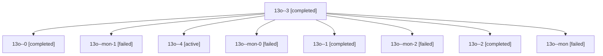

# Session: 13o

[Agent Hoods](../README.md) / [bbugyi200](../users/bbugyi200/README.md) / [athena](../users/bbugyi200/machines/athena/README.md) / [13o](../users/bbugyi200/machines/athena/hoods/13o/README.md) / 13o

Owner: `bbugyi200.athena` · Hood: `13o` · Members: 9

## Lineage



The diagram is an optional enhancement; the ordered table below contains the same lineage in accessible text.

| Role | Agent | State | Model / provider | Timing | Commits | Prompt | Chat |
|---|---|---|---|---|---:|---|---|
| <a id="member-3"></a>3 | 13o--3 | completed | gpt-6-astra / codex | 2026-10-24T14:13:43.097359+00:00 → 2026-10-24T14:28:00.143355+00:00 | 0 | [Prompt](../agents/bbugyi200.athena.13o--3/prompt.md) | [Chat](../agents/bbugyi200.athena.13o--3/chat.md) |
| <a id="member-0"></a>0 | 13o--0 | completed | gpt-6-astra / codex | 2026-10-24T12:17:57.545464+00:00 → 2026-10-24T12:36:48.476493+00:00 | 0 | [Prompt](../agents/bbugyi200.athena.13o--0/prompt.md) | [Chat](../agents/bbugyi200.athena.13o--0/chat.md) |
| <a id="member-mon-1"></a>mon-1 | 13o--mon-1 | failed | gpt-6-astra / codex | 2026-10-24T13:06:29.509569+00:00 → 2026-10-24T14:04:43.098110+00:00 | 0 | — | [Chat](../agents/bbugyi200.athena.13o--mon-1/chat.md) |
| <a id="member-4"></a>4 | 13o--4 | active | gpt-6-astra / codex | 2026-10-24T15:12:53.599005+00:00 | [1](../agents/bbugyi200.athena.13o--4/README.md#commits) | [Prompt](../agents/bbugyi200.athena.13o--4/prompt.md) | — |
| <a id="member-mon-0"></a>mon-0 | 13o--mon-0 | failed | gpt-6-astra / codex | 2026-10-24T12:50:46.845231+00:00 → 2026-10-24T12:57:53.556576+00:00 | 0 | — | [Chat](../agents/bbugyi200.athena.13o--mon-0/chat.md) |
| <a id="member-1"></a>1 | 13o--1 | completed | gpt-6-astra / codex | 2026-10-24T12:42:04.006872+00:00 → 2026-10-24T12:51:57.842625+00:00 | 0 | [Prompt](../agents/bbugyi200.athena.13o--1/prompt.md) | [Chat](../agents/bbugyi200.athena.13o--1/chat.md) |
| <a id="member-mon-2"></a>mon-2 | 13o--mon-2 | failed | gpt-6-astra / codex | 2026-10-24T14:25:26.517493+00:00 → 2026-10-24T15:11:30.711178+00:00 | 0 | — | [Chat](../agents/bbugyi200.athena.13o--mon-2/chat.md) |
| <a id="member-2"></a>2 | 13o--2 | completed | gpt-6-astra / codex | 2026-10-24T12:59:26.972878+00:00 → 2026-10-24T13:07:11.187863+00:00 | 0 | [Prompt](../agents/bbugyi200.athena.13o--2/prompt.md) | [Chat](../agents/bbugyi200.athena.13o--2/chat.md) |
| <a id="member-mon"></a>mon | 13o--mon | failed | gpt-6-astra / codex | 2026-10-24T12:31:35.439524+00:00 → 2026-10-24T12:39:49.969129+00:00 | 0 | — | [Chat](../agents/bbugyi200.athena.13o--mon/chat.md) |

## Commits

| Role | Repo | Commit | Subject | Committed |
|---|---|---|---|---|
| 4 | sase | [`7b1b437`](https://github.com/sase-org/sase/commit/7b1b43755821fb4b6fe9ab8f51d09fcff0e46879) | feat(agents-sync): add report-first repair for stale publication revision rows (sase-1nv.4) | 2026-10-24 11:48:49 EDT |
| — | sase | [`602ff33`](https://github.com/sase-org/sase/commit/602ff33c1b2aa7a33e94552ca248e1ca43faa6a3) | feat(autonomy): make built-in questions wait for human answers | 2026-10-24 12:58:56 EDT |

## Variables

| Role | Variable | Value |
|---|---|---|
| 4 | `artifacts` | \[{kind: file, label: Monitor chatty-child idle-timeout fail and unchanged-tree serial pass during conflict repair, path: /home/bryan/.sase/artifacts/agents/gh\_sase-org\_\_sase/20261024111030/conflict-r… |

#### artifacts

**Role:** `4`

```yaml
- kind: file
  label: Monitor chatty-child idle-timeout fail and unchanged-tree serial pass during conflict repair
  path: /home/bryan/.sase/artifacts/agents/gh_sase-org__sase/20261024111030/conflict-repair-monitor-flake-e96ccb820dec.log
  ref: file:explicit:7fc04c8b30c432d4bd1fd53c
  source_path: /home/bryan/.local/state/sase/workspaces/sase-org/sase/sase_14/.git/conflict-repair-monitor-flake.log
```

Values are truncated for display; see each member's agent meta.json for the full values.
