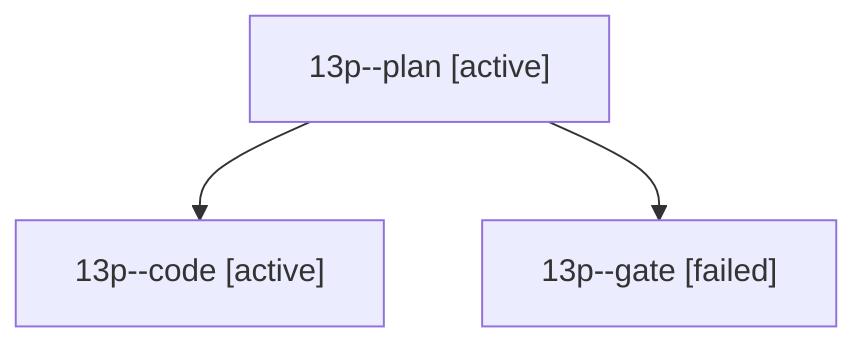

# Session: 13p

[Agent Hoods](../README.md) / [bbugyi200](../users/bbugyi200/README.md) / [athena](../users/bbugyi200/machines/athena/README.md) / [13p](../users/bbugyi200/machines/athena/hoods/13p/README.md) / 13p

Owner: `bbugyi200.athena` · Hood: `13p` · Members: 3

## Lineage

The diagram is an optional enhancement; the ordered table below contains the same lineage in accessible text.

| Role | Agent | State | Model / provider | Timing | Commits | Prompt | Chat |
|---|---|---|---|---|---:|---|---|
| plan | 13p--plan | active | opus / claude | 2026-10-24T15:41:16.763930+00:00 | 0 | [Prompt](../agents/bbugyi200.athena.13p--plan/prompt.md) | [Chat](../agents/bbugyi200.athena.13p--plan/chat.md) |
| code | 13p--code | active | muse-spark-1.3-contributor / muse | 2026-10-24T15:47:48.571554+00:00 | 0 | — | — |
| gate | 13p--gate | failed | opus / claude | 2026-10-24T15:46:54.498380+00:00 → 2026-10-24T15:47:26.638382+00:00 | 0 | — | [Chat](../agents/bbugyi200.athena.13p--gate/chat.md) |
