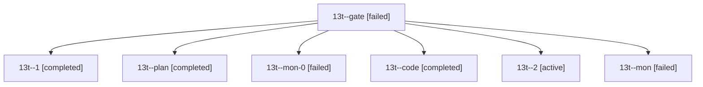

# Session: 13t

[Agent Hoods](../README.md) / [bbugyi200](../users/bbugyi200/README.md) / [athena](../users/bbugyi200/machines/athena/README.md) / [13t](../users/bbugyi200/machines/athena/hoods/13t/README.md) / 13t

Owner: `bbugyi200.athena` · Hood: `13t` · Members: 7

## Lineage

The diagram is an optional enhancement; the ordered table below contains the same lineage in accessible text.

| Role | Agent | State | Model / provider | Timing | Commits | Prompt | Chat |
|---|---|---|---|---|---:|---|---|
| gate | 13t--gate | failed | opus / claude | 2026-10-24T18:51:20.856901+00:00 → 2026-10-24T18:53:06.739829+00:00 | 0 | — | [Chat](../agents/bbugyi200.athena.13t--gate/chat.md) |
| 1 | 13t--1 | completed | muse-spark-1.3-contributor / muse | 2026-10-24T19:37:37.945650+00:00 → 2026-10-24T19:43:36.432145+00:00 | 0 | [Prompt](../agents/bbugyi200.athena.13t--1/prompt.md) | [Chat](../agents/bbugyi200.athena.13t--1/chat.md) |
| plan | 13t--plan | completed | opus / claude | 2026-10-24T18:29:43.696821+00:00 → 2026-10-24T18:48:17.122687+00:00 | 0 | [Prompt](../agents/bbugyi200.athena.13t--plan/prompt.md) | [Chat](../agents/bbugyi200.athena.13t--plan/chat.md) |
| mon-0 | 13t--mon-0 | failed | muse-spark-1.3-contributor / muse | 2026-10-24T19:42:31.386007+00:00 → 2026-10-24T20:18:47.769300+00:00 | [1](../agents/bbugyi200.athena.13t--mon-0/README.md#commits) | — | [Chat](../agents/bbugyi200.athena.13t--mon-0/chat.md) |
| code | 13t--code | completed | muse-spark-1.3-contributor / muse | 2026-10-24T18:54:05.749190+00:00 → 2026-10-24T19:20:11.791073+00:00 | 0 | [Prompt](../agents/bbugyi200.athena.13t--code/prompt.md) | [Chat](../agents/bbugyi200.athena.13t--code/chat.md) |
| 2 | 13t--2 | active | muse-spark-1.3-contributor / muse | 20261024161747 | 0 | [Prompt](../agents/bbugyi200.athena.13t--2/prompt.md) | — |
| mon | 13t--mon | failed | muse-spark-1.3-contributor / muse | 2026-10-24T19:19:37.482755+00:00 → 2026-10-24T19:36:05.612536+00:00 | 0 | — | [Chat](../agents/bbugyi200.athena.13t--mon/chat.md) |

## Commits

| Role | Repo | Commit | Subject | Committed |
|---|---|---|---|---|
| mon-0 | sase | [`9012f46`](https://github.com/sase-org/sase/commit/9012f46cf94b27734df7dc9b692629340a58ac1e) | fix(lease): rescue dirty leased checkout and harden provider continuation | 2026-10-24 16:16:02 EDT |
