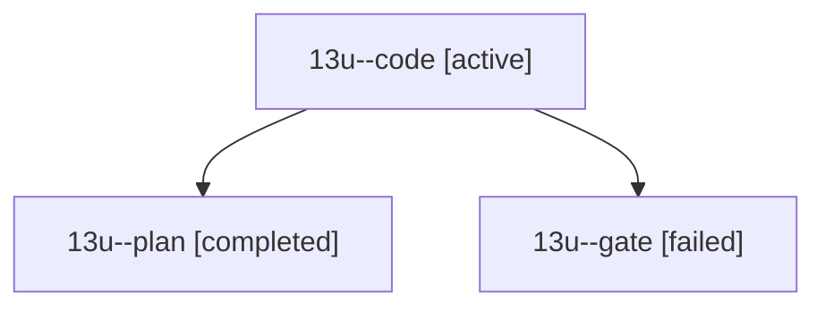

# Session: 13u

[Agent Hoods](../README.md) / [bbugyi200](../users/bbugyi200/README.md) / [athena](../users/bbugyi200/machines/athena/README.md) / [13u](../users/bbugyi200/machines/athena/hoods/13u/README.md) / 13u

Owner: `bbugyi200.athena` · Hood: `13u` · Members: 3

## Lineage

The diagram is an optional enhancement; the ordered table below contains the same lineage in accessible text.

| Role | Agent | State | Model / provider | Timing | Commits | Prompt | Chat |
|---|---|---|---|---|---:|---|---|
| code | 13u--code | active | gpt-6-luna / codex | 2026-10-24T18:54:56.108995+00:00 | [1](../agents/bbugyi200.athena.13u--code/README.md#commits) | [Prompt](../agents/bbugyi200.athena.13u--code/prompt.md) | — |
| plan | 13u--plan | completed | opus / claude | 2026-10-24T18:34:26.969588+00:00 → 2026-10-24T18:45:42.561302+00:00 | 0 | [Prompt](../agents/bbugyi200.athena.13u--plan/prompt.md) | [Chat](../agents/bbugyi200.athena.13u--plan/chat.md) |
| gate | 13u--gate | failed | opus / claude | 2026-10-24T18:52:30.635259+00:00 → 2026-10-24T18:54:10.533374+00:00 | 0 | — | [Chat](../agents/bbugyi200.athena.13u--gate/chat.md) |

## Commits

| Role | Repo | Commit | Subject | Committed |
|---|---|---|---|---|
| code | sase | [`c594443`](https://github.com/sase-org/sase/commit/c594443dc78c5acde55e25f25c73e573647e5560) | feat(monitor): add zero-weight wait monitors | 2026-10-24 15:21:16 EDT |
