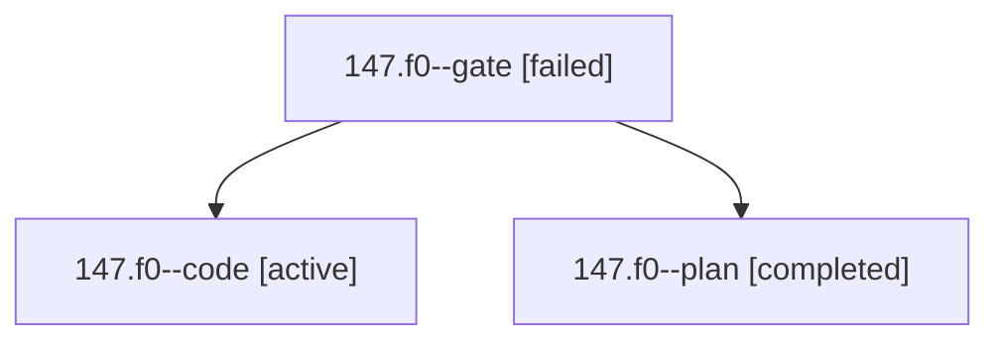

# Session: 147.f0

[Agent Hoods](../README.md) / [bbugyi200](../users/bbugyi200/README.md) / [athena](../users/bbugyi200/machines/athena/README.md) / [147](../users/bbugyi200/machines/athena/hoods/147/README.md) / 147.f0

Owner: `bbugyi200.athena` · Hood: `147` · Members: 3

## Lineage

The diagram is an optional enhancement; the ordered table below contains the same lineage in accessible text.

| Role | Agent | State | Model / provider | Timing | Commits | Prompt | Chat |
|---|---|---|---|---|---:|---|---|
| gate | 147.f0--gate | failed | opus / claude | 2026-10-25T19:21:40.526270+00:00 → 2026-10-25T19:23:42.199096+00:00 | 0 | — | [Chat](../agents/bbugyi200.athena.147.f0--gate/chat.md) |
| code | 147.f0--code | active | muse-spark-1.3-contributor / muse | 2026-10-25T19:24:26.539259+00:00 | [1](../agents/bbugyi200.athena.147.f0--code/README.md#commits) | [Prompt](../agents/bbugyi200.athena.147.f0--code/prompt.md) | — |
| plan | 147.f0--plan | completed | opus / claude | 2026-10-25T19:04:25.839756+00:00 → 2026-10-25T19:22:01.430983+00:00 | 0 | [Prompt](../agents/bbugyi200.athena.147.f0--plan/prompt.md) | [Chat](../agents/bbugyi200.athena.147.f0--plan/chat.md) |

## Commits

| Role | Repo | Commit | Subject | Committed |
|---|---|---|---|---|
| code | sase | [`ce75abd`](https://github.com/sase-org/sase/commit/ce75abd76fde594214503c2b55562a39d96e3584) | feat(project-stats): label Swift languages and surface uncounted files | 2026-10-25 17:06:38 EDT |

## Neighbors

| Agent | Relation | State |
|---|---|---|
| [147](bbugyi200.athena.147.md) (session · 5) | ancestor | completed 3, failed 2 |
