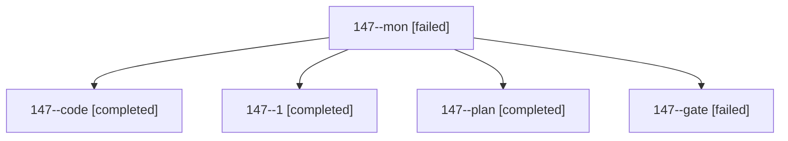

# Session: 147

[Agent Hoods](../README.md) / [bbugyi200](../users/bbugyi200/README.md) / [athena](../users/bbugyi200/machines/athena/README.md) / [147](../users/bbugyi200/machines/athena/hoods/147/README.md) / 147

Owner: `bbugyi200.athena` · Hood: `147` · Members: 5

## Lineage

The diagram is an optional enhancement; the ordered table below contains the same lineage in accessible text.

| Role | Agent | State | Model / provider | Timing | Commits | Prompt | Chat |
|---|---|---|---|---|---:|---|---|
| mon | 147--mon | failed | muse-spark-1.3-contributor / muse | 2026-10-25T18:33:20.213621+00:00 → 2026-10-25T18:36:23.142594+00:00 | 0 | — | [Chat](../agents/bbugyi200.athena.147--mon/chat.md) |
| code | 147--code | completed | muse-spark-1.3-contributor / muse | 2026-10-25T17:39:46.235735+00:00 → 2026-10-25T18:34:01.615078+00:00 | 0 | [Prompt](../agents/bbugyi200.athena.147--code/prompt.md) | [Chat](../agents/bbugyi200.athena.147--code/chat.md) |
| 1 | 147--1 | completed | muse-spark-1.3-contributor / muse | 2026-10-25T18:37:18.044144+00:00 → 2026-10-25T18:47:08.618797+00:00 | [1](../agents/bbugyi200.athena.147--1/README.md#commits) | [Prompt](../agents/bbugyi200.athena.147--1/prompt.md) | [Chat](../agents/bbugyi200.athena.147--1/chat.md) |
| plan | 147--plan | completed | opus / claude | 2026-10-25T17:18:32.866594+00:00 → 2026-10-25T17:34:30.101776+00:00 | 0 | [Prompt](../agents/bbugyi200.athena.147--plan/prompt.md) | [Chat](../agents/bbugyi200.athena.147--plan/chat.md) |
| gate | 147--gate | failed | opus / claude | 2026-10-25T17:37:32.656385+00:00 → 2026-10-25T17:39:03.336548+00:00 | 0 | — | [Chat](../agents/bbugyi200.athena.147--gate/chat.md) |

## Commits

| Role | Repo | Commit | Subject | Committed |
|---|---|---|---|---|
| 1 | sase | [`ba59799`](https://github.com/sase-org/sase/commit/ba59799ce95e7a9697dc7877276adec4274898f1) | feat(stats): add project language breakdown with rows card and repo LANGUAGE column | 2026-10-25 14:45:01 EDT |

## Neighbors

| Agent | Relation | State |
|---|---|---|
| [147.f0](bbugyi200.athena.147.f0.md) (session · 3) | descendant | active 1, completed 1, failed 1 |
