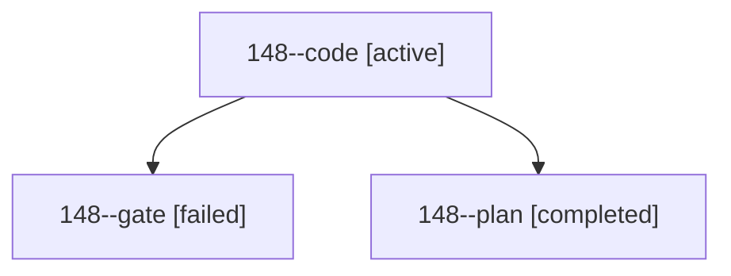

# Session: 148

[Agent Hoods](../README.md) / [bbugyi200](../users/bbugyi200/README.md) / [athena](../users/bbugyi200/machines/athena/README.md) / [148](../users/bbugyi200/machines/athena/hoods/148/README.md) / 148

Owner: `bbugyi200.athena` · Hood: `148` · Members: 3

## Lineage

The diagram is an optional enhancement; the ordered table below contains the same lineage in accessible text.

| Role | Agent | State | Model / provider | Timing | Commits | Prompt | Chat |
|---|---|---|---|---|---:|---|---|
| code | 148--code | active | muse-spark-1.3-contributor / muse | 2026-10-25T17:40:22.421845+00:00 | [1](../agents/bbugyi200.athena.148--code/README.md#commits) | [Prompt](../agents/bbugyi200.athena.148--code/prompt.md) | — |
| gate | 148--gate | failed | opus / claude | 2026-10-25T17:38:18.784914+00:00 → 2026-10-25T17:39:39.183167+00:00 | 0 | — | [Chat](../agents/bbugyi200.athena.148--gate/chat.md) |
| plan | 148--plan | completed | opus / claude | 2026-10-25T17:20:24.375544+00:00 → 2026-10-25T17:37:03.737821+00:00 | 0 | [Prompt](../agents/bbugyi200.athena.148--plan/prompt.md) | [Chat](../agents/bbugyi200.athena.148--plan/chat.md) |

## Commits

| Role | Repo | Commit | Subject | Committed |
|---|---|---|---|---|
| code | sase | [`529a1bd`](https://github.com/sase-org/sase/commit/529a1bd46d8619d90563914a9455d9a913a5c609) | fix(gate): route turn-bearing specs through gate-turn transaction | 2026-10-25 14:05:52 EDT |
