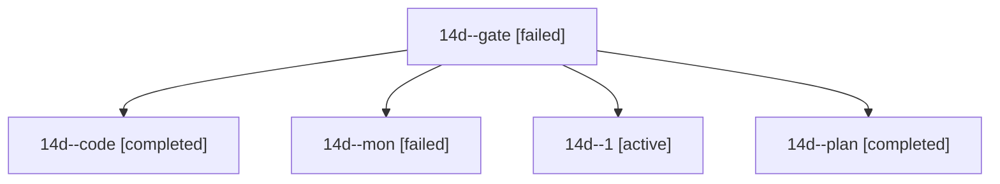

# Session: 14d

[Agent Hoods](../README.md) / [bbugyi200](../users/bbugyi200/README.md) / [athena](../users/bbugyi200/machines/athena/README.md) / [14d](../users/bbugyi200/machines/athena/hoods/14d/README.md) / 14d

Owner: `bbugyi200.athena` · Hood: `14d` · Members: 5

## Lineage

The diagram is an optional enhancement; the ordered table below contains the same lineage in accessible text.

| Role | Agent | State | Model / provider | Timing | Commits | Prompt | Chat |
|---|---|---|---|---|---:|---|---|
| gate | 14d--gate | failed | opus / claude | 2026-10-25T19:45:16.392199+00:00 → 2026-10-25T19:46:45.915635+00:00 | 0 | — | [Chat](../agents/bbugyi200.athena.14d--gate/chat.md) |
| code | 14d--code | completed | muse-spark-1.3-contributor / muse | 2026-10-25T19:47:51.808377+00:00 → 2026-10-25T20:05:52.989478+00:00 | 0 | [Prompt](../agents/bbugyi200.athena.14d--code/prompt.md) | [Chat](../agents/bbugyi200.athena.14d--code/chat.md) |
| mon | 14d--mon | failed | muse-spark-1.3-contributor / muse | 2026-10-25T20:02:38.191141+00:00 → 2026-10-25T20:12:26.999187+00:00 | 0 | — | [Chat](../agents/bbugyi200.athena.14d--mon/chat.md) |
| 1 | 14d--1 | active | muse-spark-1.3-contributor / muse | 2026-10-25T20:13:58.377871+00:00 | [1](../agents/bbugyi200.athena.14d--1/README.md#commits) | [Prompt](../agents/bbugyi200.athena.14d--1/prompt.md) | — |
| plan | 14d--plan | completed | opus / claude | 2026-10-25T19:27:42.711298+00:00 → 2026-10-25T19:35:32.010220+00:00 | 0 | [Prompt](../agents/bbugyi200.athena.14d--plan/prompt.md) | [Chat](../agents/bbugyi200.athena.14d--plan/chat.md) |

## Commits

| Role | Repo | Commit | Subject | Committed |
|---|---|---|---|---|
| 1 | sase | [`a643c38`](https://github.com/sase-org/sase/commit/a643c38640e1a3abb39f553a5cd4a9b7329dc4f1) | feat(gate): surface command exec header with narrow unstartable recovery | 2026-10-25 16:15:52 EDT |
