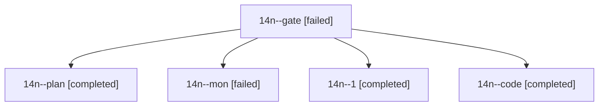

# Session: 14n

[Agent Hoods](../README.md) / [bbugyi200](../users/bbugyi200/README.md) / [athena](../users/bbugyi200/machines/athena/README.md) / [14n](../users/bbugyi200/machines/athena/hoods/14n/README.md) / 14n

Owner: `bbugyi200.athena` · Hood: `14n` · Members: 5

## Lineage

The diagram is an optional enhancement; the ordered table below contains the same lineage in accessible text.

| Role | Agent | State | Model / provider | Timing | Commits | Prompt | Chat |
|---|---|---|---|---|---:|---|---|
| gate | 14n--gate | failed | opus / claude | 2026-10-26T20:11:12.492874+00:00 → 2026-10-26T20:12:59.838397+00:00 | 0 | — | [Chat](../agents/bbugyi200.athena.14n--gate/chat.md) |
| plan | 14n--plan | completed | opus / claude | 2026-10-26T19:52:07.549406+00:00 → 2026-10-26T20:07:07.671400+00:00 | 0 | [Prompt](../agents/bbugyi200.athena.14n--plan/prompt.md) | [Chat](../agents/bbugyi200.athena.14n--plan/chat.md) |
| mon | 14n--mon | failed | muse-spark-1.3-contributor / muse | 2026-10-26T20:27:20.560850+00:00 → 2026-10-26T20:31:10.813183+00:00 | 0 | — | [Chat](../agents/bbugyi200.athena.14n--mon/chat.md) |
| 1 | 14n--1 | completed | muse-spark-1.3-contributor / muse | 2026-10-26T20:32:20.481102+00:00 → 2026-10-26T20:37:55.374090+00:00 | 0 | [Prompt](../agents/bbugyi200.athena.14n--1/prompt.md) | [Chat](../agents/bbugyi200.athena.14n--1/chat.md) |
| code | 14n--code | completed | muse-spark-1.3-contributor / muse | 2026-10-26T20:13:44.018104+00:00 → 2026-10-26T20:28:27.316504+00:00 | 0 | [Prompt](../agents/bbugyi200.athena.14n--code/prompt.md) | [Chat](../agents/bbugyi200.athena.14n--code/chat.md) |
