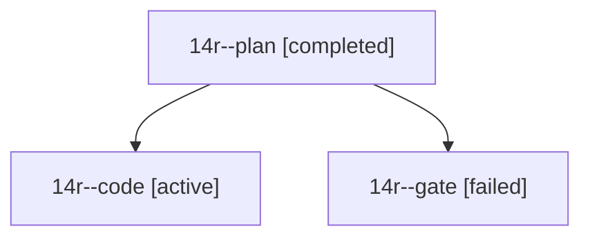

# Session: 14r

[Agent Hoods](../README.md) / [bbugyi200](../users/bbugyi200/README.md) / [athena](../users/bbugyi200/machines/athena/README.md) / [14r](../users/bbugyi200/machines/athena/hoods/14r/README.md) / 14r

Owner: `bbugyi200.athena` · Hood: `14r` · Members: 3

## Lineage

The diagram is an optional enhancement; the ordered table below contains the same lineage in accessible text.

| Role | Agent | State | Model / provider | Timing | Commits | Prompt | Chat |
|---|---|---|---|---|---:|---|---|
| plan | 14r--plan | completed | opus / claude | 2026-10-27T14:25:13.353660+00:00 → 2026-10-27T14:38:31.107910+00:00 | 0 | [Prompt](../agents/bbugyi200.athena.14r--plan/prompt.md) | [Chat](../agents/bbugyi200.athena.14r--plan/chat.md) |
| code | 14r--code | active | gpt-6-luna / codex | 2026-10-27T14:41:38.383964+00:00 | [1](../agents/bbugyi200.athena.14r--code/README.md#commits) | [Prompt](../agents/bbugyi200.athena.14r--code/prompt.md) | — |
| gate | 14r--gate | failed | opus / claude | 2026-10-27T14:38:47.691187+00:00 → 2026-10-27T14:40:44.681545+00:00 | 0 | — | [Chat](../agents/bbugyi200.athena.14r--gate/chat.md) |

## Commits

| Role | Repo | Commit | Subject | Committed |
|---|---|---|---|---|
| code | sase | [`3b99dac`](https://github.com/sase-org/sase/commit/3b99dac0a0bdafc3dcce6e0737bc88c8d925251c) | feat(monitor): label waits by their blockers | 2026-10-27 11:10:07 EDT |
