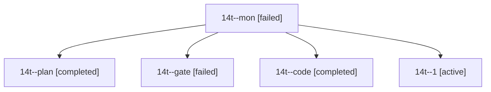

# Session: 14t

[Agent Hoods](../README.md) / [bbugyi200](../users/bbugyi200/README.md) / [athena](../users/bbugyi200/machines/athena/README.md) / [14t](../users/bbugyi200/machines/athena/hoods/14t/README.md) / 14t

Owner: `bbugyi200.athena` · Hood: `14t` · Members: 5

## Lineage

The diagram is an optional enhancement; the ordered table below contains the same lineage in accessible text.

| Role | Agent | State | Model / provider | Timing | Commits | Prompt | Chat |
|---|---|---|---|---|---:|---|---|
| mon | 14t--mon | failed | muse-spark-1.3-contributor / muse | 2026-10-27T16:20:51.026676+00:00 → 2026-10-27T16:50:46.344904+00:00 | 0 | — | [Chat](../agents/bbugyi200.athena.14t--mon/chat.md) |
| plan | 14t--plan | completed | opus / claude | 2026-10-27T15:33:57.598881+00:00 → 2026-10-27T15:48:10.385041+00:00 | 0 | [Prompt](../agents/bbugyi200.athena.14t--plan/prompt.md) | [Chat](../agents/bbugyi200.athena.14t--plan/chat.md) |
| gate | 14t--gate | failed | opus / claude | 2026-10-27T15:47:08.717784+00:00 → 2026-10-27T15:53:36.359149+00:00 | 0 | — | [Chat](../agents/bbugyi200.athena.14t--gate/chat.md) |
| code | 14t--code | completed | muse-spark-1.3-contributor / muse | 2026-10-27T15:55:53.274815+00:00 → 2026-10-27T16:21:32.774889+00:00 | 0 | [Prompt](../agents/bbugyi200.athena.14t--code/prompt.md) | [Chat](../agents/bbugyi200.athena.14t--code/chat.md) |
| 1 | 14t--1 | active | muse-spark-1.3-contributor / muse | 2026-10-27T16:52:20.499642+00:00 | [1](../agents/bbugyi200.athena.14t--1/README.md#commits) | [Prompt](../agents/bbugyi200.athena.14t--1/prompt.md) | — |

## Commits

| Role | Repo | Commit | Subject | Committed |
|---|---|---|---|---|
| 1 | sase | [`8d41b72`](https://github.com/sase-org/sase/commit/8d41b722182145e16bf572b1d3a76a2fffad0f4c) | fix(ace): keep queued agent sessions and their clans QUEUED across capacity refreshes | 2026-10-27 12:57:24 EDT |
