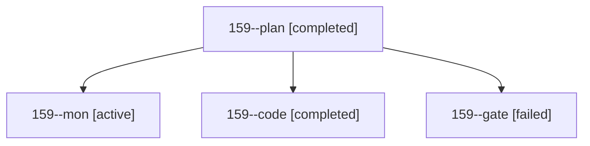

# Session: 159

[Agent Hoods](../README.md) / [bbugyi200](../users/bbugyi200/README.md) / [athena](../users/bbugyi200/machines/athena/README.md) / [159](../users/bbugyi200/machines/athena/hoods/159/README.md) / 159

Owner: `bbugyi200.athena` · Hood: `159` · Members: 4

## Lineage

The diagram is an optional enhancement; the ordered table below contains the same lineage in accessible text.

| Role | Agent | State | Model / provider | Timing | Commits | Prompt | Chat |
|---|---|---|---|---|---:|---|---|
| plan | 159--plan | completed | opus / claude | 2026-10-28T16:27:29.769681+00:00 → 2026-10-28T17:11:07.184349+00:00 | 0 | [Prompt](../agents/bbugyi200.athena.159--plan/prompt.md) | [Chat](../agents/bbugyi200.athena.159--plan/chat.md) |
| mon | 159--mon | active | gpt-6-luna / codex | 2026-10-28T17:09:54.142200+00:00 | 0 | — | — |
| code | 159--code | completed | gpt-6-luna / codex | 2026-10-28T16:47:31.107030+00:00 → 2026-10-28T17:11:07.184349+00:00 | 0 | — | [Chat](../agents/bbugyi200.athena.159--code/chat.md) |
| gate | 159--gate | failed | opus / claude | 2026-10-28T16:45:34.577654+00:00 → 2026-10-28T16:46:43.609059+00:00 | 0 | — | [Chat](../agents/bbugyi200.athena.159--gate/chat.md) |
