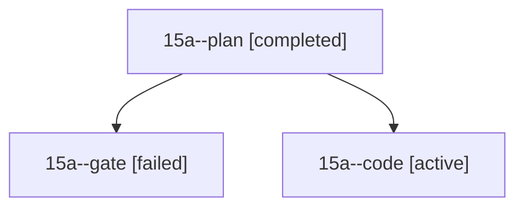

# Session: 15a

[Agent Hoods](../README.md) / [bbugyi200](../users/bbugyi200/README.md) / [athena](../users/bbugyi200/machines/athena/README.md) / [15a](../users/bbugyi200/machines/athena/hoods/15a/README.md) / 15a

Owner: `bbugyi200.athena` · Hood: `15a` · Members: 3

## Lineage

The diagram is an optional enhancement; the ordered table below contains the same lineage in accessible text.

| Role | Agent | State | Model / provider | Timing | Commits | Prompt | Chat |
|---|---|---|---|---|---:|---|---|
| plan | 15a--plan | completed | opus / claude | 2026-10-28T18:37:00.158887+00:00 → 2026-10-28T18:48:59.171603+00:00 | 0 | [Prompt](../agents/bbugyi200.athena.15a--plan/prompt.md) | [Chat](../agents/bbugyi200.athena.15a--plan/chat.md) |
| gate | 15a--gate | failed | opus / claude | 2026-10-28T18:49:54.520893+00:00 → 2026-10-28T18:51:59.132115+00:00 | 0 | — | [Chat](../agents/bbugyi200.athena.15a--gate/chat.md) |
| code | 15a--code | active | muse-spark-1.3-contributor / muse | 2026-10-28T18:53:29.199571+00:00 | [1](../agents/bbugyi200.athena.15a--code/README.md#commits) | [Prompt](../agents/bbugyi200.athena.15a--code/prompt.md) | — |

## Commits

| Role | Repo | Commit | Subject | Committed |
|---|---|---|---|---|
| code | sase | [`564bdcd`](https://github.com/sase-org/sase/commit/564bdcdcb903637d5eabd9eb0387c09b87150ac4) | feat(ace): make every gate input and decision reachable | 2026-10-28 15:26:33 EDT |
