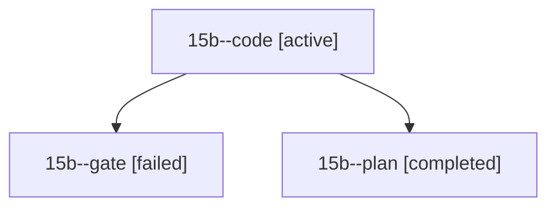

# Session: 15b

[Agent Hoods](../README.md) / [bbugyi200](../users/bbugyi200/README.md) / [athena](../users/bbugyi200/machines/athena/README.md) / [15b](../users/bbugyi200/machines/athena/hoods/15b/README.md) / 15b

Owner: `bbugyi200.athena` · Hood: `15b` · Members: 3

## Lineage

The diagram is an optional enhancement; the ordered table below contains the same lineage in accessible text.

| Role | Agent | State | Model / provider | Timing | Commits | Prompt | Chat |
|---|---|---|---|---|---:|---|---|
| code | 15b--code | active | gpt-6-luna / codex | 2026-10-28T18:51:41.923613+00:00 | [1](../agents/bbugyi200.athena.15b--code/README.md#commits) | [Prompt](../agents/bbugyi200.athena.15b--code/prompt.md) | — |
| gate | 15b--gate | failed | opus / claude | 2026-10-28T18:47:43.148432+00:00 → 2026-10-28T18:50:06.431393+00:00 | 0 | — | [Chat](../agents/bbugyi200.athena.15b--gate/chat.md) |
| plan | 15b--plan | completed | opus / claude | 2026-10-28T18:39:20.815710+00:00 → 2026-10-28T18:45:30.188403+00:00 | 0 | [Prompt](../agents/bbugyi200.athena.15b--plan/prompt.md) | [Chat](../agents/bbugyi200.athena.15b--plan/chat.md) |

## Commits

| Role | Repo | Commit | Subject | Committed |
|---|---|---|---|---|
| code | sase | [`2cf68a0`](https://github.com/sase-org/sase/commit/2cf68a0d4b753eed49376491999b6f49965ea744) | fix(tui): jump to stopped agents inside collapsed clans | 2026-10-28 15:10:22 EDT |
