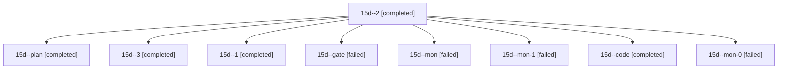

# Session: 15d

[Agent Hoods](../README.md) / [bbugyi200](../users/bbugyi200/README.md) / [athena](../users/bbugyi200/machines/athena/README.md) / [15d](../users/bbugyi200/machines/athena/hoods/15d/README.md) / 15d

Owner: `bbugyi200.athena` · Hood: `15d` · Members: 9

## Lineage

The diagram is an optional enhancement; the ordered table below contains the same lineage in accessible text.

| Role | Agent | State | Model / provider | Timing | Commits | Prompt | Chat |
|---|---|---|---|---|---:|---|---|
| 2 | 15d--2 | completed | grok-4.6 / grok | 2026-10-28T21:29:58.661442+00:00 → 2026-10-28T21:38:38.335596+00:00 | 0 | [Prompt](../agents/bbugyi200.athena.15d--2/prompt.md) | [Chat](../agents/bbugyi200.athena.15d--2/chat.md) |
| plan | 15d--plan | completed | opus / claude | 2026-10-28T19:48:55.870396+00:00 → 2026-10-28T19:58:24.577980+00:00 | 0 | [Prompt](../agents/bbugyi200.athena.15d--plan/prompt.md) | [Chat](../agents/bbugyi200.athena.15d--plan/chat.md) |
| 3 | 15d--3 | completed | grok-4.6 / grok | 2026-10-28T22:06:10.820298+00:00 → 2026-10-28T22:39:06.728186+00:00 | [1](../agents/bbugyi200.athena.15d--3/README.md#commits) | [Prompt](../agents/bbugyi200.athena.15d--3/prompt.md) | [Chat](../agents/bbugyi200.athena.15d--3/chat.md) |
| 1 | 15d--1 | completed | grok-4.6 / grok | 2026-10-28T20:23:11.004946+00:00 → 2026-10-28T20:32:40.148602+00:00 | 0 | [Prompt](../agents/bbugyi200.athena.15d--1/prompt.md) | [Chat](../agents/bbugyi200.athena.15d--1/chat.md) |
| gate | 15d--gate | failed | opus / claude | 2026-10-28T19:58:52.840093+00:00 → 2026-10-28T20:01:00.656774+00:00 | 0 | — | [Chat](../agents/bbugyi200.athena.15d--gate/chat.md) |
| mon | 15d--mon | failed | grok-4.6 / grok | 2026-10-28T20:14:53.396912+00:00 → 2026-10-28T20:21:06.902447+00:00 | 0 | — | [Chat](../agents/bbugyi200.athena.15d--mon/chat.md) |
| mon-1 | 15d--mon-1 | failed | grok-4.6 / grok | 2026-10-28T21:37:55.095204+00:00 → 2026-10-28T22:04:04.673189+00:00 | 0 | — | [Chat](../agents/bbugyi200.athena.15d--mon-1/chat.md) |
| code | 15d--code | completed | grok-4.6 / grok | 2026-10-28T20:02:25.315079+00:00 → 2026-10-28T20:15:28.805067+00:00 | 0 | [Prompt](../agents/bbugyi200.athena.15d--code/prompt.md) | [Chat](../agents/bbugyi200.athena.15d--code/chat.md) |
| mon-0 | 15d--mon-0 | failed | grok-4.6 / grok | 2026-10-28T20:31:49.879780+00:00 → 2026-10-28T21:27:45.332250+00:00 | 0 | — | [Chat](../agents/bbugyi200.athena.15d--mon-0/chat.md) |

## Commits

| Role | Repo | Commit | Subject | Committed |
|---|---|---|---|---|
| 3 | sase | [`02716dc`](https://github.com/sase-org/sase/commit/02716dcbc0d1a298f7b81e4bf4975eeab05c652c) | feat(tui): jump to clan members from every Agents-tab entry | 2026-10-28 18:37:14 EDT |
