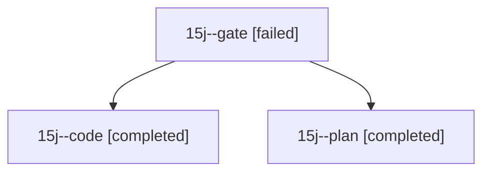

# Session: 15j

[Agent Hoods](../README.md) / [bbugyi200](../users/bbugyi200/README.md) / [athena](../users/bbugyi200/machines/athena/README.md) / [15j](../users/bbugyi200/machines/athena/hoods/15j/README.md) / 15j

Owner: `bbugyi200.athena` · Hood: `15j` · Members: 3

## Lineage

The diagram is an optional enhancement; the ordered table below contains the same lineage in accessible text.

| Role | Agent | State | Model / provider | Timing | Commits | Prompt | Chat |
|---|---|---|---|---|---:|---|---|
| gate | 15j--gate | failed | opus / claude | 2026-10-28T22:12:02.247067+00:00 → 2026-10-28T22:14:09.213151+00:00 | 0 | — | [Chat](../agents/bbugyi200.athena.15j--gate/chat.md) |
| code | 15j--code | completed | grok-4.6 / grok | 2026-10-28T22:16:24.326441+00:00 → 2026-10-28T22:59:52.741283+00:00 | [1](../agents/bbugyi200.athena.15j--code/README.md#commits) | [Prompt](../agents/bbugyi200.athena.15j--code/prompt.md) | [Chat](../agents/bbugyi200.athena.15j--code/chat.md) |
| plan | 15j--plan | completed | opus / claude | 2026-10-28T21:59:59.254404+00:00 → 2026-10-28T22:05:43.345301+00:00 | 0 | [Prompt](../agents/bbugyi200.athena.15j--plan/prompt.md) | [Chat](../agents/bbugyi200.athena.15j--plan/chat.md) |

## Commits

| Role | Repo | Commit | Subject | Committed |
|---|---|---|---|---|
| code | sase | [`c33e975`](https://github.com/sase-org/sase/commit/c33e97574633a027ab3cc9323cbfa8f9d9b78b73) | fix(tui): treat pending custom gates as stopped for ,J | 2026-10-28 18:54:15 EDT |
