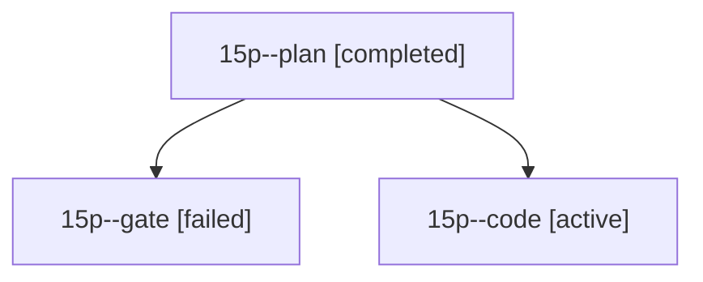

# Session: 15p

[Agent Hoods](../README.md) / [bbugyi200](../users/bbugyi200/README.md) / [athena](../users/bbugyi200/machines/athena/README.md) / [15p](../users/bbugyi200/machines/athena/hoods/15p/README.md) / 15p

Owner: `bbugyi200.athena` · Hood: `15p` · Members: 3

## Lineage

The diagram is an optional enhancement; the ordered table below contains the same lineage in accessible text.

| Role | Agent | State | Model / provider | Timing | Commits | Prompt | Chat |
|---|---|---|---|---|---:|---|---|
| plan | 15p--plan | completed | opus / claude | 2026-10-29T01:57:23.548955+00:00 → 2026-10-29T02:08:03.015066+00:00 | 0 | [Prompt](../agents/bbugyi200.athena.15p--plan/prompt.md) | [Chat](../agents/bbugyi200.athena.15p--plan/chat.md) |
| gate | 15p--gate | failed | opus / claude | 2026-10-29T02:08:24.704663+00:00 → 2026-10-29T02:10:58.030168+00:00 | 0 | — | [Chat](../agents/bbugyi200.athena.15p--gate/chat.md) |
| code | 15p--code | active | muse-spark-1.3-contributor / muse | 2026-10-29T02:12:27.942947+00:00 | [1](../agents/bbugyi200.athena.15p--code/README.md#commits) | [Prompt](../agents/bbugyi200.athena.15p--code/prompt.md) | — |

## Commits

| Role | Repo | Commit | Subject | Committed |
|---|---|---|---|---|
| code | sase | [`e59d425`](https://github.com/sase-org/sase/commit/e59d4255aef192fd4931f03fc2cd1443503c68a1) | fix(ace): light jump targets for sessions running a monitor | 2026-10-28 23:57:45 EDT |
