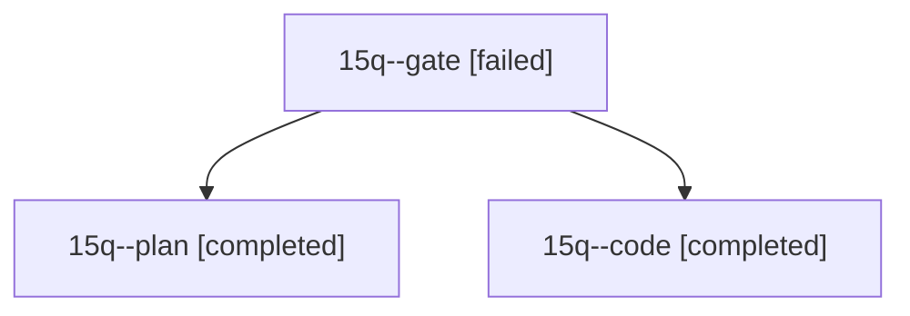

# Session: 15q

[Agent Hoods](../README.md) / [bbugyi200](../users/bbugyi200/README.md) / [athena](../users/bbugyi200/machines/athena/README.md) / [15q](../users/bbugyi200/machines/athena/hoods/15q/README.md) / 15q

Owner: `bbugyi200.athena` · Hood: `15q` · Members: 3

## Lineage

The diagram is an optional enhancement; the ordered table below contains the same lineage in accessible text.

| Role | Agent | State | Model / provider | Timing | Commits | Prompt | Chat |
|---|---|---|---|---|---:|---|---|
| gate | 15q--gate | failed | opus / claude | 2026-10-29T05:20:53.515894+00:00 → 2026-10-29T05:23:18.074055+00:00 | 0 | — | [Chat](../agents/bbugyi200.athena.15q--gate/chat.md) |
| plan | 15q--plan | completed | opus / claude | 2026-10-29T04:27:26.905885+00:00 → 2026-10-29T05:20:51.800764+00:00 | 0 | [Prompt](../agents/bbugyi200.athena.15q--plan/prompt.md) | [Chat](../agents/bbugyi200.athena.15q--plan/chat.md) |
| code | 15q--code | completed | gpt-6-luna / codex | 2026-10-29T05:25:05.438181+00:00 → 2026-10-29T06:00:54.261928+00:00 | 0 | [Prompt](../agents/bbugyi200.athena.15q--code/prompt.md) | [Chat](../agents/bbugyi200.athena.15q--code/chat.md) |
