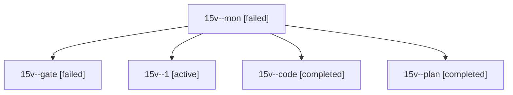

# Session: 15v

[Agent Hoods](../README.md) / [bbugyi200](../users/bbugyi200/README.md) / [athena](../users/bbugyi200/machines/athena/README.md) / [15v](../users/bbugyi200/machines/athena/hoods/15v/README.md) / 15v

Owner: `bbugyi200.athena` · Hood: `15v` · Members: 5

## Lineage

The diagram is an optional enhancement; the ordered table below contains the same lineage in accessible text.

| Role | Agent | State | Model / provider | Timing | Commits | Prompt | Chat |
|---|---|---|---|---|---:|---|---|
| mon | 15v--mon | failed | muse-spark-1.3-contributor / muse | 2026-10-29T17:15:54.347077+00:00 → 2026-10-29T17:47:13.398061+00:00 | 0 | — | [Chat](../agents/bbugyi200.athena.15v--mon/chat.md) |
| gate | 15v--gate | failed | opus / claude | 2026-10-29T16:52:29.811663+00:00 → 2026-10-29T16:55:14.840954+00:00 | 0 | — | [Chat](../agents/bbugyi200.athena.15v--gate/chat.md) |
| 1 | 15v--1 | active | muse-spark-1.3-contributor / muse | 2026-10-29T17:49:30.063092+00:00 | [1](../agents/bbugyi200.athena.15v--1/README.md#commits) | [Prompt](../agents/bbugyi200.athena.15v--1/prompt.md) | — |
| code | 15v--code | completed | muse-spark-1.3-contributor / muse | 2026-10-29T16:57:03.574895+00:00 → 2026-10-29T17:19:18.845959+00:00 | 0 | [Prompt](../agents/bbugyi200.athena.15v--code/prompt.md) | [Chat](../agents/bbugyi200.athena.15v--code/chat.md) |
| plan | 15v--plan | completed | opus / claude | 2026-10-29T16:36:02.425440+00:00 → 2026-10-29T16:45:35.862221+00:00 | 0 | [Prompt](../agents/bbugyi200.athena.15v--plan/prompt.md) | [Chat](../agents/bbugyi200.athena.15v--plan/chat.md) |

## Commits

| Role | Repo | Commit | Subject | Committed |
|---|---|---|---|---|
| 1 | sase | [`227d5df`](https://github.com/sase-org/sase/commit/227d5df196a910edd3158ce4db3d5b8613d2cab7) | feat(agents): add Monitoring status group to BY\_STATUS/BY\_MACHINE | 2026-10-29 13:53:21 EDT |
