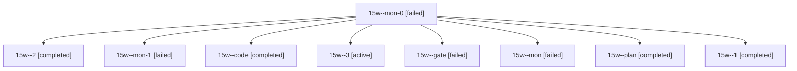

# Session: 15w

[Agent Hoods](../README.md) / [bbugyi200](../users/bbugyi200/README.md) / [athena](../users/bbugyi200/machines/athena/README.md) / [15w](../users/bbugyi200/machines/athena/hoods/15w/README.md) / 15w

Owner: `bbugyi200.athena` · Hood: `15w` · Members: 9

## Lineage

The diagram is an optional enhancement; the ordered table below contains the same lineage in accessible text.

| Role | Agent | State | Model / provider | Timing | Commits | Prompt | Chat |
|---|---|---|---|---|---:|---|---|
| mon-0 | 15w--mon-0 | failed | gpt-6-luna / codex | 2026-10-29T19:15:33.755781+00:00 → 2026-10-29T19:51:12.154726+00:00 | 0 | — | [Chat](../agents/bbugyi200.athena.15w--mon-0/chat.md) |
| 2 | 15w--2 | completed | gpt-6-luna / codex | 2026-10-29T19:53:27.577893+00:00 → 2026-10-29T20:00:16.619910+00:00 | 0 | [Prompt](../agents/bbugyi200.athena.15w--2/prompt.md) | [Chat](../agents/bbugyi200.athena.15w--2/chat.md) |
| mon-1 | 15w--mon-1 | failed | gpt-6-luna / codex | 2026-10-29T19:59:05.504501+00:00 → 2026-10-29T20:25:07.837080+00:00 | 0 | — | [Chat](../agents/bbugyi200.athena.15w--mon-1/chat.md) |
| code | 15w--code | completed | gpt-6-luna / codex | 2026-10-29T18:03:44.077976+00:00 → 2026-10-29T18:19:50.431962+00:00 | 0 | [Prompt](../agents/bbugyi200.athena.15w--code/prompt.md) | [Chat](../agents/bbugyi200.athena.15w--code/chat.md) |
| 3 | 15w--3 | active | muse-spark-1.3-contributor / muse | 2026-10-29T20:27:41.870986+00:00 | [1](../agents/bbugyi200.athena.15w--3/README.md#commits) | [Prompt](../agents/bbugyi200.athena.15w--3/prompt.md) | — |
| gate | 15w--gate | failed | opus / claude | 2026-10-29T17:59:29.626288+00:00 → 2026-10-29T18:02:05.158944+00:00 | 0 | — | [Chat](../agents/bbugyi200.athena.15w--gate/chat.md) |
| mon | 15w--mon | failed | gpt-6-luna / codex | 2026-10-29T18:18:01.503706+00:00 → 2026-10-29T18:21:50.734491+00:00 | 0 | — | [Chat](../agents/bbugyi200.athena.15w--mon/chat.md) |
| plan | 15w--plan | completed | opus / claude | 2026-10-29T17:43:09.190896+00:00 → 2026-10-29T17:59:01.579197+00:00 | 0 | [Prompt](../agents/bbugyi200.athena.15w--plan/prompt.md) | [Chat](../agents/bbugyi200.athena.15w--plan/chat.md) |
| 1 | 15w--1 | completed | gpt-6-luna / codex | 2026-10-29T18:23:47.174346+00:00 → 2026-10-29T19:18:10.358499+00:00 | 0 | [Prompt](../agents/bbugyi200.athena.15w--1/prompt.md) | [Chat](../agents/bbugyi200.athena.15w--1/chat.md) |

## Commits

| Role | Repo | Commit | Subject | Committed |
|---|---|---|---|---|
| 3 | sase | [`50431ba`](https://github.com/sase-org/sase/commit/50431ba3bb11b762f988bbf277e977a338551311) | feat(gate-turn): make question answers durable and recover interrupted handoffs | 2026-10-29 17:13:04 EDT |
