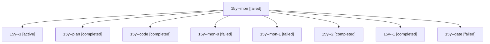

# Session: 15y

[Agent Hoods](../README.md) / [bbugyi200](../users/bbugyi200/README.md) / [athena](../users/bbugyi200/machines/athena/README.md) / [15y](../users/bbugyi200/machines/athena/hoods/15y/README.md) / 15y

Owner: `bbugyi200.athena` · Hood: `15y` · Members: 9

## Lineage

The diagram is an optional enhancement; the ordered table below contains the same lineage in accessible text.

| Role | Agent | State | Model / provider | Timing | Commits | Prompt | Chat |
|---|---|---|---|---|---:|---|---|
| mon | 15y--mon | failed | grok-4.6 / grok | 2026-10-29T20:08:41.923009+00:00 → 2026-10-29T21:10:36.012297+00:00 | 0 | — | [Chat](../agents/bbugyi200.athena.15y--mon/chat.md) |
| 3 | 15y--3 | active | grok-4.6 / grok | 2026-10-29T22:49:15.716362+00:00 | [1](../agents/bbugyi200.athena.15y--3/README.md#commits) | [Prompt](../agents/bbugyi200.athena.15y--3/prompt.md) | — |
| plan | 15y--plan | completed | opus / claude | 2026-10-29T19:34:59.692920+00:00 → 2026-10-29T19:45:52.038109+00:00 | 0 | [Prompt](../agents/bbugyi200.athena.15y--plan/prompt.md) | [Chat](../agents/bbugyi200.athena.15y--plan/chat.md) |
| code | 15y--code | completed | grok-4.6 / grok | 2026-10-29T20:01:46.279869+00:00 → 2026-10-29T20:11:17.758768+00:00 | 0 | [Prompt](../agents/bbugyi200.athena.15y--code/prompt.md) | [Chat](../agents/bbugyi200.athena.15y--code/chat.md) |
| mon-0 | 15y--mon-0 | failed | grok-4.6 / grok | 2026-10-29T21:18:22.474475+00:00 → 2026-10-29T22:03:21.935837+00:00 | 0 | — | [Chat](../agents/bbugyi200.athena.15y--mon-0/chat.md) |
| mon-1 | 15y--mon-1 | failed | grok-4.6 / grok | 2026-10-29T22:10:26.573714+00:00 → 2026-10-29T22:45:00.924355+00:00 | 0 | — | [Chat](../agents/bbugyi200.athena.15y--mon-1/chat.md) |
| 2 | 15y--2 | completed | grok-4.6 / grok | 2026-10-29T22:05:39.056085+00:00 → 2026-10-29T22:11:22.843542+00:00 | 0 | [Prompt](../agents/bbugyi200.athena.15y--2/prompt.md) | [Chat](../agents/bbugyi200.athena.15y--2/chat.md) |
| 1 | 15y--1 | completed | grok-4.6 / grok | 2026-10-29T21:13:17.582623+00:00 → 2026-10-29T21:21:06.704535+00:00 | 0 | [Prompt](../agents/bbugyi200.athena.15y--1/prompt.md) | [Chat](../agents/bbugyi200.athena.15y--1/chat.md) |
| gate | 15y--gate | failed | opus / claude | 2026-10-29T19:57:45.195847+00:00 → 2026-10-29T20:00:10.565454+00:00 | 0 | — | [Chat](../agents/bbugyi200.athena.15y--gate/chat.md) |

## Commits

| Role | Repo | Commit | Subject | Committed |
|---|---|---|---|---|
| 3 | sase | [`b4d59ac`](https://github.com/sase-org/sase/commit/b4d59ac50e14a5714a7e1f0f450a271bf6799a1a) | fix(tui): skip GC survivor census on CPython before 3.14 | 2026-10-29 18:53:48 EDT |
