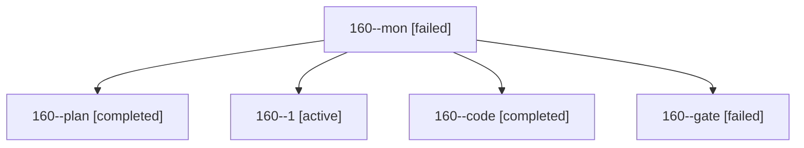

# Session: 160

[Agent Hoods](../README.md) / [bbugyi200](../users/bbugyi200/README.md) / [athena](../users/bbugyi200/machines/athena/README.md) / [160](../users/bbugyi200/machines/athena/hoods/160/README.md) / 160

Owner: `bbugyi200.athena` · Hood: `160` · Members: 5

## Lineage

The diagram is an optional enhancement; the ordered table below contains the same lineage in accessible text.

| Role | Agent | State | Model / provider | Timing | Commits | Prompt | Chat |
|---|---|---|---|---|---:|---|---|
| mon | 160--mon | failed | muse-spark-1.3-contributor / muse | 2026-10-29T22:21:50.533014+00:00 → 2026-10-29T22:29:40.255115+00:00 | 0 | — | [Chat](../agents/bbugyi200.athena.160--mon/chat.md) |
| plan | 160--plan | completed | opus / claude | 2026-10-29T21:50:55.455352+00:00 → 2026-10-29T22:04:14.936929+00:00 | 0 | [Prompt](../agents/bbugyi200.athena.160--plan/prompt.md) | [Chat](../agents/bbugyi200.athena.160--plan/chat.md) |
| 1 | 160--1 | active | muse-spark-1.3-contributor / muse | 2026-10-29T22:45:09.755429+00:00 | 0 | [Prompt](../agents/bbugyi200.athena.160--1/prompt.md) | — |
| code | 160--code | completed | muse-spark-1.3-contributor / muse | 2026-10-29T22:08:47.917452+00:00 → 2026-10-29T22:23:19.403779+00:00 | 0 | [Prompt](../agents/bbugyi200.athena.160--code/prompt.md) | [Chat](../agents/bbugyi200.athena.160--code/chat.md) |
| gate | 160--gate | failed | opus / claude | 2026-10-29T22:04:12.824323+00:00 → 2026-10-29T22:07:18.598351+00:00 | 0 | — | [Chat](../agents/bbugyi200.athena.160--gate/chat.md) |
