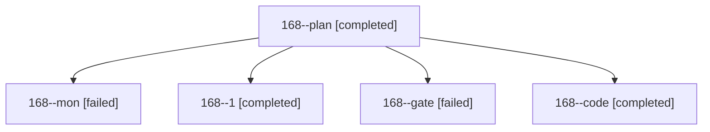

# Session: 168

[Agent Hoods](../README.md) / [bbugyi200](../users/bbugyi200/README.md) / [athena](../users/bbugyi200/machines/athena/README.md) / [168](../users/bbugyi200/machines/athena/hoods/168/README.md) / 168

Owner: `bbugyi200.athena` · Hood: `168` · Members: 5

## Lineage

The diagram is an optional enhancement; the ordered table below contains the same lineage in accessible text.

| Role | Agent | State | Model / provider | Timing | Commits | Prompt | Chat |
|---|---|---|---|---|---:|---|---|
| plan | 168--plan | completed | opus / claude | 2026-10-30T14:11:03.712262+00:00 → 2026-10-30T14:29:36.814789+00:00 | 0 | [Prompt](../agents/bbugyi200.athena.168--plan/prompt.md) | [Chat](../agents/bbugyi200.athena.168--plan/chat.md) |
| mon | 168--mon | failed | muse-spark-1.3-contributor / muse | 2026-10-30T14:50:45.333543+00:00 → 2026-10-30T15:08:51.191033+00:00 | 0 | — | [Chat](../agents/bbugyi200.athena.168--mon/chat.md) |
| 1 | 168--1 | completed | muse-spark-1.3-contributor / muse | 2026-10-30T15:11:34.416203+00:00 → 2026-10-30T15:27:50.589363+00:00 | [1](../agents/bbugyi200.athena.168--1/README.md#commits) | [Prompt](../agents/bbugyi200.athena.168--1/prompt.md) | [Chat](../agents/bbugyi200.athena.168--1/chat.md) |
| gate | 168--gate | failed | opus / claude | 2026-10-30T14:31:09.992810+00:00 → 2026-10-30T14:33:51.021233+00:00 | 0 | — | [Chat](../agents/bbugyi200.athena.168--gate/chat.md) |
| code | 168--code | completed | muse-spark-1.3-contributor / muse | 2026-10-30T14:35:36.982381+00:00 → 2026-10-30T14:51:08.592397+00:00 | 0 | [Prompt](../agents/bbugyi200.athena.168--code/prompt.md) | [Chat](../agents/bbugyi200.athena.168--code/chat.md) |

## Commits

| Role | Repo | Commit | Subject | Committed |
|---|---|---|---|---|
| 1 | sase | [`86bec79`](https://github.com/sase-org/sase/commit/86bec79ca4e62144bbfb3f34526e7f5a74d299b9) | feat(agents-sync): fix agent\_state\_refresh timeouts and scheduler wedging | 2026-10-30 11:27:36 EDT |
