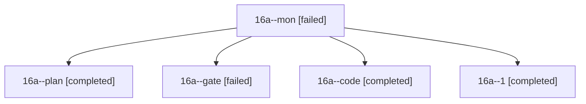

# Session: 16a

[Agent Hoods](../README.md) / [bbugyi200](../users/bbugyi200/README.md) / [athena](../users/bbugyi200/machines/athena/README.md) / [16a](../users/bbugyi200/machines/athena/hoods/16a/README.md) / 16a

Owner: `bbugyi200.athena` · Hood: `16a` · Members: 5

## Lineage



The diagram is an optional enhancement; the ordered table below contains the same lineage in accessible text.

| Role | Agent | State | Model / provider | Timing | Commits | Prompt | Chat |
|---|---|---|---|---|---:|---|---|
| <a id="member-mon"></a>mon | 16a--mon | failed | gpt-6-luna / codex | 2026-10-30T14:55:01.595504+00:00 → 2026-10-30T15:04:48.811736+00:00 | 0 | — | [Chat](../agents/bbugyi200.athena.16a--mon/chat.md) |
| <a id="member-plan"></a>plan | 16a--plan | completed | opus / claude | 2026-10-30T14:29:47.677953+00:00 → 2026-10-30T14:39:24.231991+00:00 | 0 | [Prompt](../agents/bbugyi200.athena.16a--plan/prompt.md) | [Chat](../agents/bbugyi200.athena.16a--plan/chat.md) |
| <a id="member-gate"></a>gate | 16a--gate | failed | opus / claude | 2026-10-30T14:40:34.288420+00:00 → 2026-10-30T14:44:17.058341+00:00 | 0 | — | [Chat](../agents/bbugyi200.athena.16a--gate/chat.md) |
| <a id="member-code"></a>code | 16a--code | completed | gpt-6-luna / codex | 2026-10-30T14:46:09.718731+00:00 → 2026-10-30T14:55:27.866928+00:00 | 0 | [Prompt](../agents/bbugyi200.athena.16a--code/prompt.md) | [Chat](../agents/bbugyi200.athena.16a--code/chat.md) |
| <a id="member-1"></a>1 | 16a--1 | completed | gpt-6-luna / codex | 2026-10-30T15:02:24.702995+00:00 → 2026-10-30T17:38:36.604267+00:00 | [1](../agents/bbugyi200.athena.16a--1/README.md#commits) | [Prompt](../agents/bbugyi200.athena.16a--1/prompt.md) | [Chat](../agents/bbugyi200.athena.16a--1/chat.md) |

## Commits

| Role | Repo | Commit | Subject | Committed |
|---|---|---|---|---|
| 1 | sase | [`d69741b`](https://github.com/sase-org/sase/commit/d69741b370fc6872d62442247082059e3ef59f73) | feat(tui): land stopped-agent jumps on Context | 2026-10-30 13:38:22 EDT |

## Variables

| Role | Variable | Value |
|---|---|---|
| 1 | `artifacts` | \[{kind: file, label: Approved check ToolRun 3ca0ba01382eb58f81f4b5063766ebe1 Symvision failure, path: /home/bryan/.sase/artifacts/agents/gh\_sase-org\_\_sase/20261030105730/stdout-377bd8e103d5.log, ref:… |

#### artifacts

**Role:** `1`

```yaml
- kind: file
  label: Approved check ToolRun 3ca0ba01382eb58f81f4b5063766ebe1 Symvision failure
  path: /home/bryan/.sase/artifacts/agents/gh_sase-org__sase/20261030105730/stdout-377bd8e103d5.log
  ref: file:explicit:550fb2439c9eec33e4392004
  source_path: /home/bryan/.sase/tools/logs/3ca0ba01382eb58f81f4b5063766ebe1/stdout.log
```

Values are truncated for display; see each member's agent meta.json for the full values.
