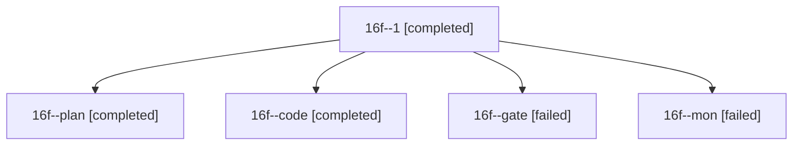

# Session: 16f

[Agent Hoods](../README.md) / [bbugyi200](../users/bbugyi200/README.md) / [athena](../users/bbugyi200/machines/athena/README.md) / [16f](../users/bbugyi200/machines/athena/hoods/16f/README.md) / 16f

Owner: `bbugyi200.athena` · Hood: `16f` · Members: 5

## Lineage

The diagram is an optional enhancement; the ordered table below contains the same lineage in accessible text.

| Role | Agent | State | Model / provider | Timing | Commits | Prompt | Chat |
|---|---|---|---|---|---:|---|---|
| 1 | 16f--1 | completed | muse-spark-1.3-contributor / muse | 2026-10-30T18:28:18.248089+00:00 → 2026-10-30T18:33:45.403579+00:00 | [1](../agents/bbugyi200.athena.16f--1/README.md#commits) | [Prompt](../agents/bbugyi200.athena.16f--1/prompt.md) | [Chat](../agents/bbugyi200.athena.16f--1/chat.md) |
| plan | 16f--plan | completed | opus / claude | 2026-10-30T16:31:33.884983+00:00 → 2026-10-30T16:43:47.143480+00:00 | 0 | [Prompt](../agents/bbugyi200.athena.16f--plan/prompt.md) | [Chat](../agents/bbugyi200.athena.16f--plan/chat.md) |
| code | 16f--code | completed | muse-spark-1.3-contributor / muse | 2026-10-30T17:01:38.467787+00:00 → 2026-10-30T17:23:31.115864+00:00 | 0 | [Prompt](../agents/bbugyi200.athena.16f--code/prompt.md) | [Chat](../agents/bbugyi200.athena.16f--code/chat.md) |
| gate | 16f--gate | failed | opus / claude | 2026-10-30T16:43:42.490941+00:00 → 2026-10-30T16:57:23.332855+00:00 | 0 | — | [Chat](../agents/bbugyi200.athena.16f--gate/chat.md) |
| mon | 16f--mon | failed | muse-spark-1.3-contributor / muse | 2026-10-30T17:23:21.382090+00:00 → 2026-10-30T18:25:12.260211+00:00 | 0 | — | [Chat](../agents/bbugyi200.athena.16f--mon/chat.md) |

## Commits

| Role | Repo | Commit | Subject | Committed |
|---|---|---|---|---|
| 1 | sase | [`96bbb23`](https://github.com/sase-org/sase/commit/96bbb23ce6dae7b171e4d1fd55f03763af14b1de) | fix(ace): keep Ctrl+J deck card choice across background repaints | 2026-10-30 14:33:33 EDT |
