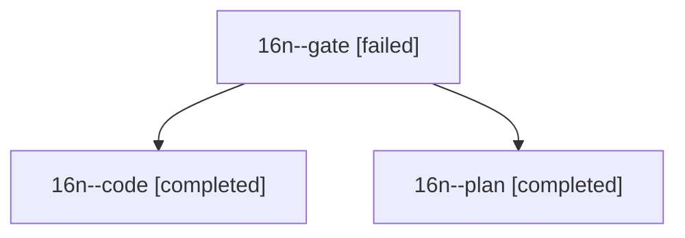

# Session: 16n

[Agent Hoods](../README.md) / [bbugyi200](../users/bbugyi200/README.md) / [athena](../users/bbugyi200/machines/athena/README.md) / [16n](../users/bbugyi200/machines/athena/hoods/16n/README.md) / 16n

Owner: `bbugyi200.athena` · Hood: `16n` · Members: 3

## Lineage

The diagram is an optional enhancement; the ordered table below contains the same lineage in accessible text.

| Role | Agent | State | Model / provider | Timing | Commits | Prompt | Chat |
|---|---|---|---|---|---:|---|---|
| gate | 16n--gate | failed | opus / claude | 2026-10-31T15:44:56.512024+00:00 → 2026-10-31T15:47:01.876684+00:00 | 0 | — | [Chat](../agents/bbugyi200.athena.16n--gate/chat.md) |
| code | 16n--code | completed | sonnet / claude | 2026-10-31T15:48:32.709202+00:00 → 2026-10-31T16:45:57.722269+00:00 | [1](../agents/bbugyi200.athena.16n--code/README.md#commits) | [Prompt](../agents/bbugyi200.athena.16n--code/prompt.md) | [Chat](../agents/bbugyi200.athena.16n--code/chat.md) |
| plan | 16n--plan | completed | opus / claude | 2026-10-31T15:31:01.956262+00:00 → 2026-10-31T15:40:38.672665+00:00 | 0 | [Prompt](../agents/bbugyi200.athena.16n--plan/prompt.md) | [Chat](../agents/bbugyi200.athena.16n--plan/chat.md) |

## Commits

| Role | Repo | Commit | Subject | Committed |
|---|---|---|---|---|
| code | sase | [`28c88b2`](https://github.com/sase-org/sase/commit/28c88b2b95f378d481cf54c7cdcce6867485cbff) | feat(glossary-preview): honor authored \[\[target\]\] links in the definition and SEE ALSO | 2026-10-31 12:45:36 EDT |
