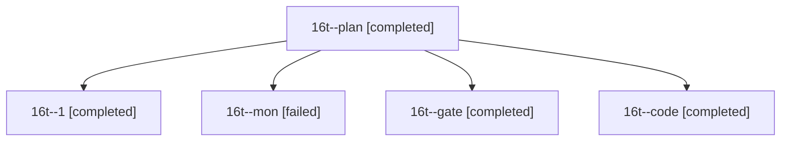

# Session: 16t

[Agent Hoods](../README.md) / [bbugyi200](../users/bbugyi200/README.md) / [athena](../users/bbugyi200/machines/athena/README.md) / [16t](../users/bbugyi200/machines/athena/hoods/16t/README.md) / 16t

Owner: `bbugyi200.athena` · Hood: `16t` · Members: 5

## Lineage

The diagram is an optional enhancement; the ordered table below contains the same lineage in accessible text.

| Role | Agent | State | Model / provider | Timing | Commits | Prompt | Chat |
|---|---|---|---|---|---:|---|---|
| plan | 16t--plan | completed | opus / claude | 2026-11-01T21:43:52.116262+00:00 → 2026-11-01T21:51:22.377826+00:00 | 0 | [Prompt](../agents/bbugyi200.athena.16t--plan/prompt.md) | [Chat](../agents/bbugyi200.athena.16t--plan/chat.md) |
| 1 | 16t--1 | completed | muse-spark-1.3-contributor / muse | 2026-11-01T23:20:48.983402+00:00 → 2026-11-01T23:39:47.005549+00:00 | [1](../agents/bbugyi200.athena.16t--1/README.md#commits) | [Prompt](../agents/bbugyi200.athena.16t--1/prompt.md) | [Chat](../agents/bbugyi200.athena.16t--1/chat.md) |
| mon | 16t--mon | failed | muse-spark-1.3-contributor / muse | 2026-11-01T22:15:42.114032+00:00 → 2026-11-01T23:17:55.071338+00:00 | 0 | — | [Chat](../agents/bbugyi200.athena.16t--mon/chat.md) |
| gate | 16t--gate | completed | opus / claude | 2026-11-01T21:52:19.352465+00:00 → 2026-11-01T21:54:27.566771+00:00 | 0 | — | [Chat](../agents/bbugyi200.athena.16t--gate/chat.md) |
| code | 16t--code | completed | muse-spark-1.3-contributor / muse | 2026-11-01T21:55:25.426170+00:00 → 2026-11-01T22:16:31.352301+00:00 | 0 | [Prompt](../agents/bbugyi200.athena.16t--code/prompt.md) | [Chat](../agents/bbugyi200.athena.16t--code/chat.md) |

## Commits

| Role | Repo | Commit | Subject | Committed |
|---|---|---|---|---|
| 1 | sase | [`b8145cb`](https://github.com/sase-org/sase/commit/b8145cb51ab40050c3404c4c6c906dd1950f4706) | feat(agents): jump l to clan lone running member with footer hint | 2026-11-01 18:39:16 EST |
