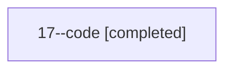

# Session: 17

[Agent Hoods](../README.md) / [bbugyi200](../users/bbugyi200/README.md) / [athena](../users/bbugyi200/machines/athena/README.md) / [17](../users/bbugyi200/machines/athena/hoods/17/README.md) / 17

Owner: `bbugyi200.athena` · Hood: `17` · Members: 1

## Lineage

The diagram is an optional enhancement; the ordered table below contains the same lineage in accessible text.

| Role | Agent | State | Model / provider | Timing | Commits | Prompt | Chat |
|---|---|---|---|---|---:|---|---|
| code | 17--code | completed | gpt-5.5 / codex | 2026-07-07T22:06:18.325280+00:00 | [1](../agents/bbugyi200.athena.17--code/README.md#commits) | — | [Chat](../agents/bbugyi200.athena.17--code/chat.md) |

## Commits

| Role | Repo | Commit | Subject | Committed |
|---|---|---|---|---|
| — | — | `0bcc1dd` | chore: Add SDD prompt and plan for ctrl\_space\_keymap | 2026-06-02 12:55:47 EDT |
| — | — | `afcd2f4` | fix: canonicalize Ctrl+Space keymaps | 2026-06-02 13:11:47 EDT |
| — | — | `0ef8267` | chore: Add SDD prompt and plan for zoom\_panel\_search | 2026-07-07 18:06:17 EDT |
| code | — | `f2d82e3` | feat(ace): add zoom panel search | 2026-07-07 18:34:24 EDT |

## Neighbors

| Agent | Relation | State |
|---|---|---|
| [17.f1](../agents/bbugyi200.athena.17.f1/README.md) | descendant | completed |
