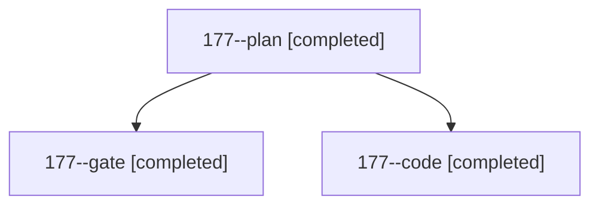

# Session: 177

[Agent Hoods](../README.md) / [bbugyi200](../users/bbugyi200/README.md) / [athena](../users/bbugyi200/machines/athena/README.md) / [177](../users/bbugyi200/machines/athena/hoods/177/README.md) / 177

Owner: `bbugyi200.athena` · Hood: `177` · Members: 3

## Lineage

The diagram is an optional enhancement; the ordered table below contains the same lineage in accessible text.

| Role | Agent | State | Model / provider | Timing | Commits | Prompt | Chat |
|---|---|---|---|---|---:|---|---|
| plan | 177--plan | completed | opus / claude | 2026-11-03T12:52:45.872190+00:00 → 2026-11-03T13:01:25.276860+00:00 | 0 | [Prompt](../agents/bbugyi200.athena.177--plan/prompt.md) | [Chat](../agents/bbugyi200.athena.177--plan/chat.md) |
| gate | 177--gate | completed | opus / claude | 2026-11-03T13:03:29.050691+00:00 → 2026-11-03T13:04:58.389955+00:00 | 0 | — | [Chat](../agents/bbugyi200.athena.177--gate/chat.md) |
| code | 177--code | completed | muse-spark-1.3-contributor / muse | 2026-11-03T13:05:32.034912+00:00 → 2026-11-03T13:45:27.179615+00:00 | [1](../agents/bbugyi200.athena.177--code/README.md#commits) | [Prompt](../agents/bbugyi200.athena.177--code/prompt.md) | [Chat](../agents/bbugyi200.athena.177--code/chat.md) |

## Commits

| Role | Repo | Commit | Subject | Committed |
|---|---|---|---|---|
| code | sase | [`258ebe7`](https://github.com/sase-org/sase/commit/258ebe7228bb6acc62730a66d952765bd1640b72) | feat(flags): unblock flag removals that close their flag bead from a gate | 2026-11-03 08:45:16 EST |
