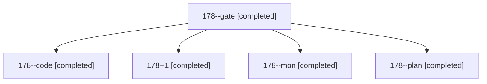

# Session: 178

[Agent Hoods](../README.md) / [bbugyi200](../users/bbugyi200/README.md) / [athena](../users/bbugyi200/machines/athena/README.md) / [178](../users/bbugyi200/machines/athena/hoods/178/README.md) / 178

Owner: `bbugyi200.athena` · Hood: `178` · Members: 5

## Lineage

The diagram is an optional enhancement; the ordered table below contains the same lineage in accessible text.

| Role | Agent | State | Model / provider | Timing | Commits | Prompt | Chat |
|---|---|---|---|---|---:|---|---|
| gate | 178--gate | completed | opus / claude | 2026-11-03T14:35:17.971680+00:00 → 2026-11-03T14:36:40.741051+00:00 | 0 | — | [Chat](../agents/bbugyi200.athena.178--gate/chat.md) |
| code | 178--code | completed | muse-spark-1.3-contributor / muse | 2026-11-03T14:37:16.333701+00:00 → 2026-11-03T14:53:38.084093+00:00 | 0 | [Prompt](../agents/bbugyi200.athena.178--code/prompt.md) | [Chat](../agents/bbugyi200.athena.178--code/chat.md) |
| 1 | 178--1 | completed | muse-spark-1.3-contributor / muse | 2026-11-03T14:56:32.334958+00:00 → 2026-11-03T14:57:19.885945+00:00 | 0 | [Prompt](../agents/bbugyi200.athena.178--1/prompt.md) | [Chat](../agents/bbugyi200.athena.178--1/chat.md) |
| mon | 178--mon | completed | muse-spark-1.3-contributor / muse | 2026-11-03T14:50:39.161106+00:00 → 2026-11-03T14:55:37.369004+00:00 | 0 | — | [Chat](../agents/bbugyi200.athena.178--mon/chat.md) |
| plan | 178--plan | completed | opus / claude | 2026-11-03T14:23:05.357290+00:00 → 2026-11-03T14:28:16.789781+00:00 | 0 | [Prompt](../agents/bbugyi200.athena.178--plan/prompt.md) | [Chat](../agents/bbugyi200.athena.178--plan/chat.md) |

## Neighbors

| Agent | Relation | State |
|---|---|---|
| [178.w0](../agents/bbugyi200.athena.178.w0/README.md) | descendant | waiting |
