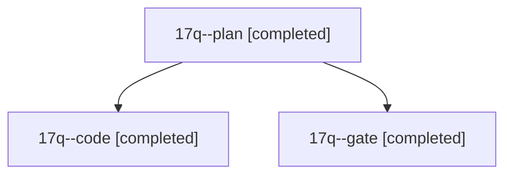

# Session: 17q

[Agent Hoods](../README.md) / [bbugyi200](../users/bbugyi200/README.md) / [athena](../users/bbugyi200/machines/athena/README.md) / [17q](../users/bbugyi200/machines/athena/hoods/17q/README.md) / 17q

Owner: `bbugyi200.athena` · Hood: `17q` · Members: 3

## Lineage



The diagram is an optional enhancement; the ordered table below contains the same lineage in accessible text.

| Role | Agent | State | Model / provider | Timing | Commits | Prompt | Chat |
|---|---|---|---|---|---:|---|---|
| <a id="member-plan"></a>plan | 17q--plan | completed | opus / claude | 2026-11-03T20:42:21.798388+00:00 → 2026-11-03T20:48:21.727544+00:00 | 0 | [Prompt](../agents/bbugyi200.athena.17q--plan/prompt.md) | [Chat](../agents/bbugyi200.athena.17q--plan/chat.md) |
| <a id="member-code"></a>code | 17q--code | completed | muse-spark-1.3-contributor / muse | 2026-11-03T20:51:24.737413+00:00 → 2026-11-03T21:15:47.818078+00:00 | 0 | [Prompt](../agents/bbugyi200.athena.17q--code/prompt.md) | [Chat](../agents/bbugyi200.athena.17q--code/chat.md) |
| <a id="member-gate"></a>gate | 17q--gate | completed | opus / claude | 2026-11-03T20:49:31.031968+00:00 → 2026-11-03T20:50:48.285549+00:00 | 0 | — | [Chat](../agents/bbugyi200.athena.17q--gate/chat.md) |

## Variables

| Role | Variable | Value |
|---|---|---|
| plan | `plan_assessment` | {alternatives\_rejected: {config\_field: A per-run, temporary evaluation knob is not a lasting user preference., delete\_now\_revert\_later: Loses per-run choice; the revert would conflict with later edit… |
| plan | `plan_confidence` | 0.8 |
| plan | `plan_verdict` | endorse\_with\_caveats |

#### plan_assessment

**Role:** `plan`

```yaml
alternatives_rejected:
  config_field: A per-run, temporary evaluation knob is not a lasting user preference.
  delete_now_revert_later: Loses per-run choice; the revert would conflict with later edits to the same lines.
  sase_feature_flag: Flags are sase-project only; wrong scope for a plugin macro.
caveats:
  - You may not need the change to start evaluating. Plain `#research_swarm` (no linker), `#research`, and `#research/more` already publish real tables, so `bob ref create` table rendering can be judged on existing reports today.
  - The real lever is the renderer. Per pandoc's pipe-table rule, when any row exceeds `--columns` (72), column widths come from the separator dash counts, so `|---|---|` gives equal-width wrapped columns. A renderer-side fix (a Lua filter that sizes columns from content, or proportional separator dashes) would help every producer, not just linker runs.
  - Interface creep: this is the 24th input on an already large macro, and temporary inputs tend to stick. Decide by a date whether to delete it.
  - Only linker runs (`linker`/`image`/`diagrams`/`audio`) are affected; the plan deliberately does not make the flag imply the linker.
suggested_follow_up: After a few real PDFs with tables, either delete the input and its true arms, or keep tables and fix widths in the renderer instead.
summary: A default-off per-run macro input is the right reversible step: it gives the end state you want today, keeps the carefully tuned conversion rule tested instead of rotting in git history, and removal later is a mechanical delete of the true arms.
why_right:
  - Easier to re-enable than `git revert c787c88`; that revert would now conflict with later diagram-era edits that reference the rule ("converted from a table into a list", the `:::` sentence, "or a diagram").
  - Per-run granularity fits an evaluation: you can A/B the same topic with and without conversion.
  - Matches the existing linker-modifier pattern (`linker_model`, `audio_edition`): it never adds an agent, so no execution-matrix churn.
  - A SASE feature flag does not fit: flags are a sase-project concern, and this lives in a plugin as a per-run choice.
```

Values are truncated for display; see each member's agent meta.json for the full values.
