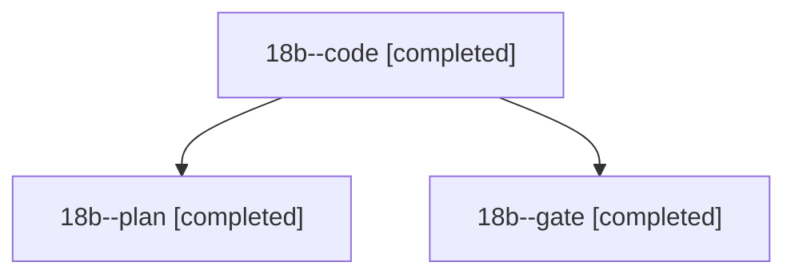

# Session: 18b

[Agent Hoods](../README.md) / [bbugyi200](../users/bbugyi200/README.md) / [athena](../users/bbugyi200/machines/athena/README.md) / [18b](../users/bbugyi200/machines/athena/hoods/18b/README.md) / 18b

Owner: `bbugyi200.athena` · Hood: `18b` · Members: 3

## Lineage

The diagram is an optional enhancement; the ordered table below contains the same lineage in accessible text.

| Role | Agent | State | Model / provider | Timing | Commits | Prompt | Chat |
|---|---|---|---|---|---:|---|---|
| code | 18b--code | completed | gpt-6-luna / codex | 2026-11-04T20:30:17.923591+00:00 → 2026-11-04T21:03:45.074975+00:00 | [1](../agents/bbugyi200.athena.18b--code/README.md#commits) | [Prompt](../agents/bbugyi200.athena.18b--code/prompt.md) | [Chat](../agents/bbugyi200.athena.18b--code/chat.md) |
| plan | 18b--plan | completed | opus / claude | 2026-11-04T20:14:38.058957+00:00 → 2026-11-04T20:22:45.729396+00:00 | 0 | [Prompt](../agents/bbugyi200.athena.18b--plan/prompt.md) | [Chat](../agents/bbugyi200.athena.18b--plan/chat.md) |
| gate | 18b--gate | completed | opus / claude | 2026-11-04T20:26:37.150411+00:00 → 2026-11-04T20:29:10.939843+00:00 | 0 | — | [Chat](../agents/bbugyi200.athena.18b--gate/chat.md) |

## Commits

| Role | Repo | Commit | Subject | Committed |
|---|---|---|---|---|
| code | sase | [`c6282f7`](https://github.com/sase-org/sase/commit/c6282f75b2aaaf553f93ac434989e0e43582a0b1) | fix(ace): omit workspace retention from agent bundles | 2026-11-04 16:03:31 EST |
