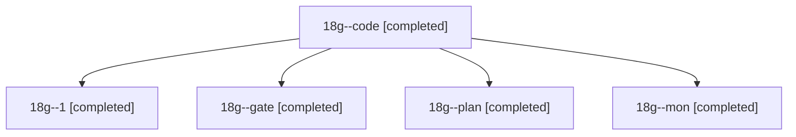

# Session: 18g

[Agent Hoods](../README.md) / [bbugyi200](../users/bbugyi200/README.md) / [athena](../users/bbugyi200/machines/athena/README.md) / [18g](../users/bbugyi200/machines/athena/hoods/18g/README.md) / 18g

Owner: `bbugyi200.athena` · Hood: `18g` · Members: 5

## Lineage

The diagram is an optional enhancement; the ordered table below contains the same lineage in accessible text.

| Role | Agent | State | Model / provider | Timing | Commits | Prompt | Chat |
|---|---|---|---|---|---:|---|---|
| code | 18g--code | completed | muse-spark-1.3-contributor / muse | 2026-11-05T11:47:37.494220+00:00 → 2026-11-05T13:07:33.787317+00:00 | 0 | [Prompt](../agents/bbugyi200.athena.18g--code/prompt.md) | [Chat](../agents/bbugyi200.athena.18g--code/chat.md) |
| 1 | 18g--1 | completed | muse-spark-1.3-contributor / muse | 2026-11-05T13:17:48.284707+00:00 → 2026-11-05T13:47:49.546237+00:00 | [1](../agents/bbugyi200.athena.18g--1/README.md#commits) | [Prompt](../agents/bbugyi200.athena.18g--1/prompt.md) | [Chat](../agents/bbugyi200.athena.18g--1/chat.md) |
| gate | 18g--gate | completed | opus / claude | 2026-11-05T11:45:07.562957+00:00 → 2026-11-05T11:46:44.871332+00:00 | 0 | — | [Chat](../agents/bbugyi200.athena.18g--gate/chat.md) |
| plan | 18g--plan | completed | opus / claude | 2026-11-05T11:30:36.393020+00:00 → 2026-11-05T11:41:53.377547+00:00 | 0 | [Prompt](../agents/bbugyi200.athena.18g--plan/prompt.md) | [Chat](../agents/bbugyi200.athena.18g--plan/chat.md) |
| mon | 18g--mon | completed | muse-spark-1.3-contributor / muse | 2026-11-05T12:06:20.502841+00:00 → 2026-11-05T13:16:29.313959+00:00 | 0 | — | [Chat](../agents/bbugyi200.athena.18g--mon/chat.md) |

## Commits

| Role | Repo | Commit | Subject | Committed |
|---|---|---|---|---|
| 1 | sase | [`71fd5b6`](https://github.com/sase-org/sase/commit/71fd5b6c2a747bb62e53fbb12eacfe1a2e1f3482) | feat(stranded): stop delivered staged handoffs from owning beads | 2026-11-05 08:47:37 EST |
