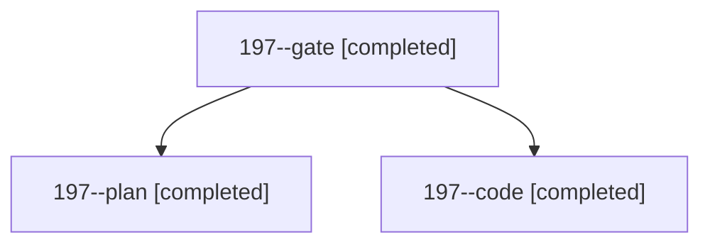

# Session: 197

[Agent Hoods](../README.md) / [bbugyi200](../users/bbugyi200/README.md) / [athena](../users/bbugyi200/machines/athena/README.md) / [197](../users/bbugyi200/machines/athena/hoods/197/README.md) / 197

Owner: `bbugyi200.athena` · Hood: `197` · Members: 3

## Lineage

The diagram is an optional enhancement; the ordered table below contains the same lineage in accessible text.

| Role | Agent | State | Model / provider | Timing | Commits | Prompt | Chat |
|---|---|---|---|---|---:|---|---|
| gate | 197--gate | completed | opus / claude | 2026-11-06T16:33:52.098935+00:00 → 2026-11-06T16:35:55.199511+00:00 | 0 | — | [Chat](../agents/bbugyi200.athena.197--gate/chat.md) |
| plan | 197--plan | completed | opus / claude | 2026-11-06T16:12:02.971842+00:00 → 2026-11-06T16:16:27.339618+00:00 | 0 | [Prompt](../agents/bbugyi200.athena.197--plan/prompt.md) | [Chat](../agents/bbugyi200.athena.197--plan/chat.md) |
| code | 197--code | completed | grok-4.6 / grok | 2026-11-06T16:36:59.207815+00:00 → 2026-11-06T17:08:45.193469+00:00 | [1](../agents/bbugyi200.athena.197--code/README.md#commits) | [Prompt](../agents/bbugyi200.athena.197--code/prompt.md) | [Chat](../agents/bbugyi200.athena.197--code/chat.md) |

## Commits

| Role | Repo | Commit | Subject | Committed |
|---|---|---|---|---|
| code | sase | [`325c36a`](https://github.com/sase-org/sase/commit/325c36a636401591b4503ac15349a12d8120b9ee) | fix(ace): show running slow tool calls newest-first | 2026-11-06 12:08:28 EST |
