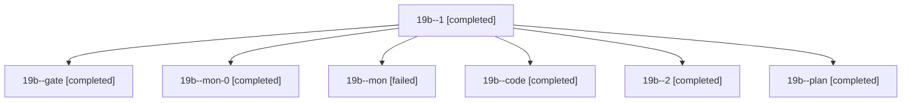

# Session: 19b

[Agent Hoods](../README.md) / [bbugyi200](../users/bbugyi200/README.md) / [athena](../users/bbugyi200/machines/athena/README.md) / [19b](../users/bbugyi200/machines/athena/hoods/19b/README.md) / 19b

Owner: `bbugyi200.athena` · Hood: `19b` · Members: 7

## Lineage

The diagram is an optional enhancement; the ordered table below contains the same lineage in accessible text.

| Role | Agent | State | Model / provider | Timing | Commits | Prompt | Chat |
|---|---|---|---|---|---:|---|---|
| 1 | 19b--1 | completed | grok-4.6 / grok | 2026-11-07T12:16:43.164478+00:00 → 2026-11-07T12:20:48.542984+00:00 | 0 | [Prompt](../agents/bbugyi200.athena.19b--1/prompt.md) | [Chat](../agents/bbugyi200.athena.19b--1/chat.md) |
| gate | 19b--gate | completed | opus / claude | 2026-11-07T11:49:20.802026+00:00 → 2026-11-07T11:50:48.273466+00:00 | 0 | — | [Chat](../agents/bbugyi200.athena.19b--gate/chat.md) |
| mon-0 | 19b--mon-0 | completed | grok-4.6 / grok | 2026-11-07T12:19:41.579020+00:00 → 2026-11-07T12:33:11.893097+00:00 | 0 | — | [Chat](../agents/bbugyi200.athena.19b--mon-0/chat.md) |
| mon | 19b--mon | failed | grok-4.6 / grok | 2026-11-07T12:08:44.723091+00:00 → 2026-11-07T12:15:38.518768+00:00 | 0 | — | [Chat](../agents/bbugyi200.athena.19b--mon/chat.md) |
| code | 19b--code | completed | grok-4.6 / grok | 2026-11-07T11:51:24.694610+00:00 → 2026-11-07T12:09:49.565521+00:00 | 0 | [Prompt](../agents/bbugyi200.athena.19b--code/prompt.md) | [Chat](../agents/bbugyi200.athena.19b--code/chat.md) |
| 2 | 19b--2 | completed | grok-4.6 / grok | 2026-11-07T12:34:34.351257+00:00 → 2026-11-07T12:38:11.049528+00:00 | [1](../agents/bbugyi200.athena.19b--2/README.md#commits) | [Prompt](../agents/bbugyi200.athena.19b--2/prompt.md) | [Chat](../agents/bbugyi200.athena.19b--2/chat.md) |
| plan | 19b--plan | completed | opus / claude | 2026-11-07T11:36:19.061036+00:00 → 2026-11-07T11:48:49.058715+00:00 | 0 | [Prompt](../agents/bbugyi200.athena.19b--plan/prompt.md) | [Chat](../agents/bbugyi200.athena.19b--plan/chat.md) |

## Commits

| Role | Repo | Commit | Subject | Committed |
|---|---|---|---|---|
| 2 | sase | [`b1329de`](https://github.com/sase-org/sase/commit/b1329de1759eedd52014313e9d0ae58066875043) | feat(init): hand sidecar-only onboarding to a terminal | 2026-11-07 07:37:55 EST |
