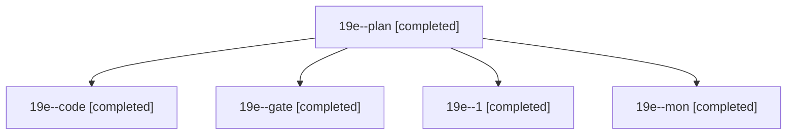

# Session: 19e

[Agent Hoods](../README.md) / [bbugyi200](../users/bbugyi200/README.md) / [athena](../users/bbugyi200/machines/athena/README.md) / [19e](../users/bbugyi200/machines/athena/hoods/19e/README.md) / 19e

Owner: `bbugyi200.athena` · Hood: `19e` · Members: 5

## Lineage

The diagram is an optional enhancement; the ordered table below contains the same lineage in accessible text.

| Role | Agent | State | Model / provider | Timing | Commits | Prompt | Chat |
|---|---|---|---|---|---:|---|---|
| plan | 19e--plan | completed | opus / claude | 2026-11-07T11:59:00.060933+00:00 → 2026-11-07T12:08:37.168299+00:00 | 0 | [Prompt](../agents/bbugyi200.athena.19e--plan/prompt.md) | [Chat](../agents/bbugyi200.athena.19e--plan/chat.md) |
| code | 19e--code | completed | muse-spark-1.3-contributor / muse | 2026-11-07T12:11:10.163272+00:00 → 2026-11-07T12:25:30.056586+00:00 | 0 | [Prompt](../agents/bbugyi200.athena.19e--code/prompt.md) | [Chat](../agents/bbugyi200.athena.19e--code/chat.md) |
| gate | 19e--gate | completed | opus / claude | 2026-11-07T12:09:02.953084+00:00 → 2026-11-07T12:10:33.266396+00:00 | 0 | — | [Chat](../agents/bbugyi200.athena.19e--gate/chat.md) |
| 1 | 19e--1 | completed | muse-spark-1.3-contributor / muse | 2026-11-07T12:38:25.019433+00:00 → 2026-11-07T12:39:33.242154+00:00 | [1](../agents/bbugyi200.athena.19e--1/README.md#commits) | [Prompt](../agents/bbugyi200.athena.19e--1/prompt.md) | [Chat](../agents/bbugyi200.athena.19e--1/chat.md) |
| mon | 19e--mon | completed | muse-spark-1.3-contributor / muse | 2026-11-07T12:24:36.869804+00:00 → 2026-11-07T12:37:19.107996+00:00 | 0 | — | [Chat](../agents/bbugyi200.athena.19e--mon/chat.md) |

## Commits

| Role | Repo | Commit | Subject | Committed |
|---|---|---|---|---|
| 1 | sase | [`0ba9cfc`](https://github.com/sase-org/sase/commit/0ba9cfc9f1ac2696cb6faeed515cd98483bcac3b) | feat(axe): pass reviewer decisions block to coder literally, detail VCS error refs | 2026-11-07 07:39:22 EST |
