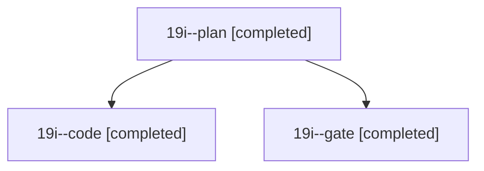

# Session: 19i

[Agent Hoods](../README.md) / [bbugyi200](../users/bbugyi200/README.md) / [athena](../users/bbugyi200/machines/athena/README.md) / [19i](../users/bbugyi200/machines/athena/hoods/19i/README.md) / 19i

Owner: `bbugyi200.athena` · Hood: `19i` · Members: 3

## Lineage



The diagram is an optional enhancement; the ordered table below contains the same lineage in accessible text.

| Role | Agent | State | Model / provider | Timing | Commits | Prompt | Chat |
|---|---|---|---|---|---:|---|---|
| <a id="member-plan"></a>plan | 19i--plan | completed | opus / claude | 2026-11-07T12:49:43.240359+00:00 → 2026-11-07T12:59:22.726174+00:00 | 0 | [Prompt](../agents/bbugyi200.athena.19i--plan/prompt.md) | [Chat](../agents/bbugyi200.athena.19i--plan/chat.md) |
| <a id="member-code"></a>code | 19i--code | completed | grok-4.6 / grok | 2026-11-07T13:03:52.687891+00:00 → 2026-11-07T15:45:49.980032+00:00 | [1](../agents/bbugyi200.athena.19i--code/README.md#commits) | [Prompt](../agents/bbugyi200.athena.19i--code/prompt.md) | [Chat](../agents/bbugyi200.athena.19i--code/chat.md) |
| <a id="member-gate"></a>gate | 19i--gate | completed | opus / claude | 2026-11-07T12:59:54.775152+00:00 → 2026-11-07T13:02:06.941359+00:00 | 0 | — | [Chat](../agents/bbugyi200.athena.19i--gate/chat.md) |

## Commits

| Role | Repo | Commit | Subject | Committed |
|---|---|---|---|---|
| code | sase | [`b7ca9f3`](https://github.com/sase-org/sase/commit/b7ca9f34503a4e348d9f5538c527ebb4b7e1d768) | feat(artifact): republish prune previews from a blocked y re-check | 2026-11-07 10:45:30 EST |

## Variables

| Role | Variable | Value |
|---|---|---|
| code | `artifacts` | \[{kind: file, label: usage-limit contention flake: scoped-check assertion failure, path: /home/bryan/.sase/artifacts/agents/gh\_sase-org\_\_sase/20261107080206/flake-usage-limit-failure-891ef9407459.txt… |

#### artifacts

**Role:** `code`

```yaml
- kind: file
  label: usage-limit contention flake: scoped-check assertion failure
  path: /home/bryan/.sase/artifacts/agents/gh_sase-org__sase/20261107080206/flake-usage-limit-failure-891ef9407459.txt
  ref: file:explicit:11ca9548f8ed4d7bf1723593
  source_path: /tmp/flake-usage-limit-failure.txt
```

Values are truncated for display; see each member's agent meta.json for the full values.
