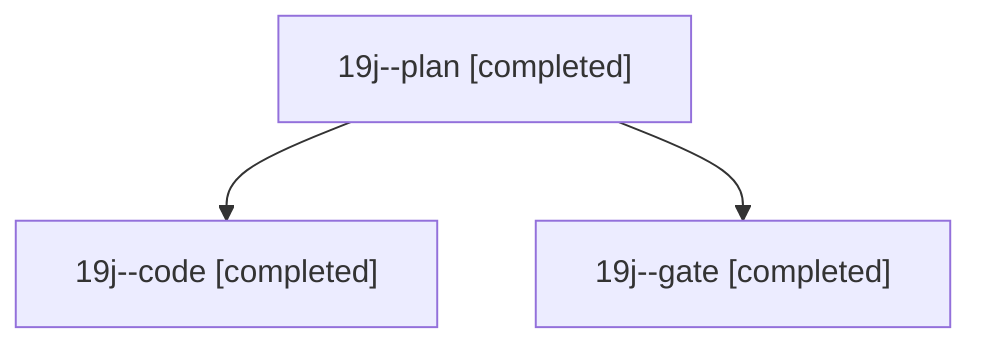

# Session: 19j

[Agent Hoods](../README.md) / [bbugyi200](../users/bbugyi200/README.md) / [athena](../users/bbugyi200/machines/athena/README.md) / [19j](../users/bbugyi200/machines/athena/hoods/19j/README.md) / 19j

Owner: `bbugyi200.athena` · Hood: `19j` · Members: 3

## Lineage

The diagram is an optional enhancement; the ordered table below contains the same lineage in accessible text.

| Role | Agent | State | Model / provider | Timing | Commits | Prompt | Chat |
|---|---|---|---|---|---:|---|---|
| plan | 19j--plan | completed | opus / claude | 2026-11-07T14:04:40.258837+00:00 → 2026-11-07T14:26:13.513116+00:00 | 0 | [Prompt](../agents/bbugyi200.athena.19j--plan/prompt.md) | [Chat](../agents/bbugyi200.athena.19j--plan/chat.md) |
| code | 19j--code | completed | opus / claude | 2026-11-07T14:31:38.276899+00:00 → 2026-11-07T15:22:59.446615+00:00 | [1](../agents/bbugyi200.athena.19j--code/README.md#commits) | [Prompt](../agents/bbugyi200.athena.19j--code/prompt.md) | [Chat](../agents/bbugyi200.athena.19j--code/chat.md) |
| gate | 19j--gate | completed | opus / claude | 2026-11-07T14:26:47.381087+00:00 → 2026-11-07T14:29:54.263499+00:00 | 0 | — | [Chat](../agents/bbugyi200.athena.19j--gate/chat.md) |

## Commits

| Role | Repo | Commit | Subject | Committed |
|---|---|---|---|---|
| code | sase | [`ef00c50`](https://github.com/sase-org/sase/commit/ef00c5097153bd36b318543b5089725be3706577) | fix(monitor): stop fencing booting follow-up receivers to needs\_attention | 2026-11-07 10:22:46 EST |
