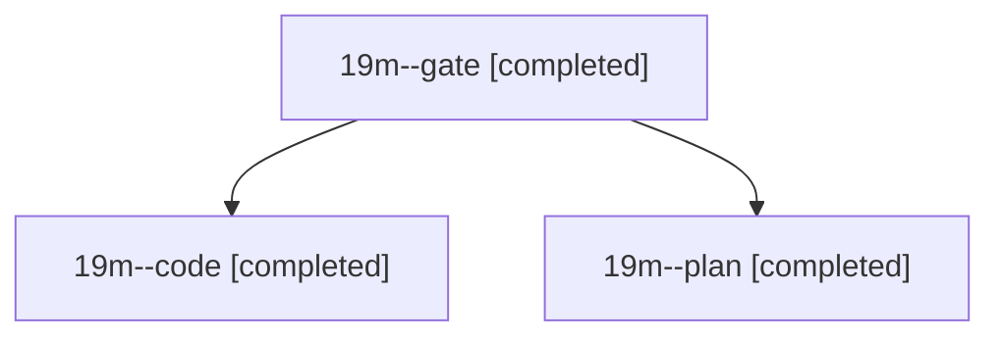

# Session: 19m

[Agent Hoods](../README.md) / [bbugyi200](../users/bbugyi200/README.md) / [athena](../users/bbugyi200/machines/athena/README.md) / [19m](../users/bbugyi200/machines/athena/hoods/19m/README.md) / 19m

Owner: `bbugyi200.athena` · Hood: `19m` · Members: 3

## Lineage

The diagram is an optional enhancement; the ordered table below contains the same lineage in accessible text.

| Role | Agent | State | Model / provider | Timing | Commits | Prompt | Chat |
|---|---|---|---|---|---:|---|---|
| gate | 19m--gate | completed | opus / claude | 2026-11-07T15:20:06.277080+00:00 → 2026-11-07T15:22:43.609993+00:00 | 0 | — | [Chat](../agents/bbugyi200.athena.19m--gate/chat.md) |
| code | 19m--code | completed | opus / claude | 2026-11-07T15:24:23.938329+00:00 → 2026-11-07T16:13:01.675569+00:00 | [1](../agents/bbugyi200.athena.19m--code/README.md#commits) | [Prompt](../agents/bbugyi200.athena.19m--code/prompt.md) | [Chat](../agents/bbugyi200.athena.19m--code/chat.md) |
| plan | 19m--plan | completed | opus / claude | 2026-11-07T14:39:59.656026+00:00 → 2026-11-07T14:57:05.340758+00:00 | 0 | [Prompt](../agents/bbugyi200.athena.19m--plan/prompt.md) | [Chat](../agents/bbugyi200.athena.19m--plan/chat.md) |

## Commits

| Role | Repo | Commit | Subject | Committed |
|---|---|---|---|---|
| code | sase | [`5692321`](https://github.com/sase-org/sase/commit/5692321a2e827eefd440f3ebb35f8f645d8c6397) | fix(artifact-links): keep artifact\_link\_backfill drains inside their budget | 2026-11-07 11:12:43 EST |
