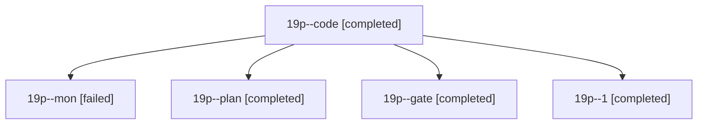

# Session: 19p

[Agent Hoods](../README.md) / [bbugyi200](../users/bbugyi200/README.md) / [athena](../users/bbugyi200/machines/athena/README.md) / [19p](../users/bbugyi200/machines/athena/hoods/19p/README.md) / 19p

Owner: `bbugyi200.athena` · Hood: `19p` · Members: 5

## Lineage

The diagram is an optional enhancement; the ordered table below contains the same lineage in accessible text.

| Role | Agent | State | Model / provider | Timing | Commits | Prompt | Chat |
|---|---|---|---|---|---:|---|---|
| code | 19p--code | completed | opus / claude | 2026-11-07T17:47:24.851615+00:00 → 2026-11-07T18:55:14.852232+00:00 | 0 | [Prompt](../agents/bbugyi200.athena.19p--code/prompt.md) | [Chat](../agents/bbugyi200.athena.19p--code/chat.md) |
| mon | 19p--mon | failed | opus / claude | 2026-11-07T18:54:29.217664+00:00 → 2026-11-07T19:46:22.486118+00:00 | 0 | — | [Chat](../agents/bbugyi200.athena.19p--mon/chat.md) |
| plan | 19p--plan | completed | opus / claude | 2026-11-07T17:20:51.244270+00:00 → 2026-11-07T17:31:33.460514+00:00 | 0 | [Prompt](../agents/bbugyi200.athena.19p--plan/prompt.md) | [Chat](../agents/bbugyi200.athena.19p--plan/chat.md) |
| gate | 19p--gate | completed | opus / claude | 2026-11-07T17:31:30.069080+00:00 → 2026-11-07T17:42:25.999808+00:00 | 0 | — | [Chat](../agents/bbugyi200.athena.19p--gate/chat.md) |
| 1 | 19p--1 | completed | opus / claude | 2026-11-07T19:48:35.752815+00:00 → 2026-11-07T19:52:45.122684+00:00 | [1](../agents/bbugyi200.athena.19p--1/README.md#commits) | [Prompt](../agents/bbugyi200.athena.19p--1/prompt.md) | [Chat](../agents/bbugyi200.athena.19p--1/chat.md) |

## Commits

| Role | Repo | Commit | Subject | Committed |
|---|---|---|---|---|
| 1 | sase | [`5922991`](https://github.com/sase-org/sase/commit/5922991bcfee7ab2d9afc615811da430ffd95a20) | feat(sidecar-sync): connect never-launched projects so artifact\_run\_prune stops failing closed | 2026-11-07 14:52:32 EST |
