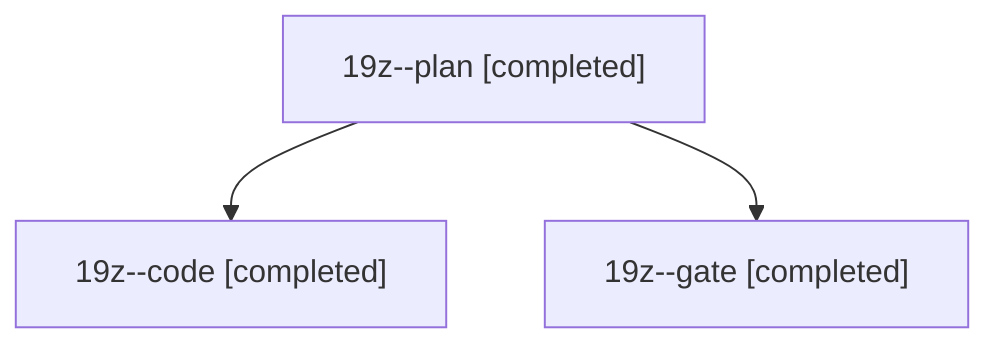

# Session: 19z

[Agent Hoods](../README.md) / [bbugyi200](../users/bbugyi200/README.md) / [athena](../users/bbugyi200/machines/athena/README.md) / [19z](../users/bbugyi200/machines/athena/hoods/19z/README.md) / 19z

Owner: `bbugyi200.athena` · Hood: `19z` · Members: 3

## Lineage



The diagram is an optional enhancement; the ordered table below contains the same lineage in accessible text.

| Role | Agent | State | Model / provider | Timing | Commits | Prompt | Chat |
|---|---|---|---|---|---:|---|---|
| <a id="member-plan"></a>plan | 19z--plan | completed | opus / claude | 2026-11-08T13:54:28.792042+00:00 → 2026-11-08T14:01:23.991312+00:00 | 0 | [Prompt](../agents/bbugyi200.athena.19z--plan/prompt.md) | [Chat](../agents/bbugyi200.athena.19z--plan/chat.md) |
| <a id="member-code"></a>code | 19z--code | completed | gpt-6-luna / codex | 2026-11-08T14:09:04.624387+00:00 → 2026-11-08T15:23:06.282334+00:00 | [1](../agents/bbugyi200.athena.19z--code/README.md#commits) | [Prompt](../agents/bbugyi200.athena.19z--code/prompt.md) | [Chat](../agents/bbugyi200.athena.19z--code/chat.md) |
| <a id="member-gate"></a>gate | 19z--gate | completed | opus / claude | 2026-11-08T14:06:18.816948+00:00 → 2026-11-08T14:08:25.008942+00:00 | 0 | — | [Chat](../agents/bbugyi200.athena.19z--gate/chat.md) |

## Commits

| Role | Repo | Commit | Subject | Committed |
|---|---|---|---|---|
| code | sase | [`bf22d45`](https://github.com/sase-org/sase/commit/bf22d456a06e678c20d122f6b958e569fc48dcdf) | feat(ace): add stranded fallback for ,j | 2026-11-08 10:22:48 EST |

## Variables

| Role | Variable | Value |
|---|---|---|
| code | `artifacts` | \[{kind: file, label: Failing Rust extension test for CI repair evidence, path: /home/bryan/.sase/artifacts/agents/gh\_sase-org\_\_sase/20261108090824/test\_core\_rust-37948c20e651.py, ref: file:explicit:d… |

#### artifacts

**Role:** `code`

```yaml
- kind: file
  label: Failing Rust extension test for CI repair evidence
  path: /home/bryan/.sase/artifacts/agents/gh_sase-org__sase/20261108090824/test_core_rust-37948c20e651.py
  ref: file:explicit:d3787cadf84b6323465845f0
  source_path: /home/bryan/.local/state/sase/workspaces/sase-org/sase/sase_13/tests/test_core_rust.py
```

Values are truncated for display; see each member's agent meta.json for the full values.
