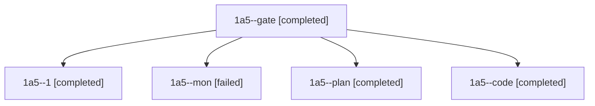

# Session: 1a5

[Agent Hoods](../README.md) / [bbugyi200](../users/bbugyi200/README.md) / [athena](../users/bbugyi200/machines/athena/README.md) / [1a5](../users/bbugyi200/machines/athena/hoods/1a5/README.md) / 1a5

Owner: `bbugyi200.athena` · Hood: `1a5` · Members: 5

## Lineage

The diagram is an optional enhancement; the ordered table below contains the same lineage in accessible text.

| Role | Agent | State | Model / provider | Timing | Commits | Prompt | Chat |
|---|---|---|---|---|---:|---|---|
| gate | 1a5--gate | completed | opus / claude | 2026-11-08T18:38:22.698336+00:00 → 2026-11-08T18:40:08.934836+00:00 | 0 | — | [Chat](../agents/bbugyi200.athena.1a5--gate/chat.md) |
| 1 | 1a5--1 | completed | muse-spark-1.3-contributor / muse | 2026-11-08T19:45:12.610263+00:00 → 2026-11-08T19:48:16.808110+00:00 | [1](../agents/bbugyi200.athena.1a5--1/README.md#commits) | [Prompt](../agents/bbugyi200.athena.1a5--1/prompt.md) | [Chat](../agents/bbugyi200.athena.1a5--1/chat.md) |
| mon | 1a5--mon | failed | muse-spark-1.3-contributor / muse | 2026-11-08T18:56:02.374266+00:00 → 2026-11-08T19:43:49.282390+00:00 | 0 | — | [Chat](../agents/bbugyi200.athena.1a5--mon/chat.md) |
| plan | 1a5--plan | completed | opus / claude | 2026-11-08T18:27:36.420675+00:00 → 2026-11-08T18:37:29.036652+00:00 | 0 | [Prompt](../agents/bbugyi200.athena.1a5--plan/prompt.md) | [Chat](../agents/bbugyi200.athena.1a5--plan/chat.md) |
| code | 1a5--code | completed | muse-spark-1.3-contributor / muse | 2026-11-08T18:41:13.128865+00:00 → 2026-11-08T18:56:55.307668+00:00 | 0 | [Prompt](../agents/bbugyi200.athena.1a5--code/prompt.md) | [Chat](../agents/bbugyi200.athena.1a5--code/chat.md) |

## Commits

| Role | Repo | Commit | Subject | Committed |
|---|---|---|---|---|
| 1 | sase | [`32a9894`](https://github.com/sase-org/sase/commit/32a9894ff0e3c1a95352a28db1a62296d16a093d) | feat(init): preview and create research sidecar on first init | 2026-11-08 14:47:54 EST |
