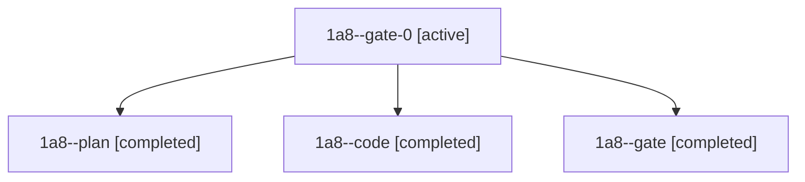

# Session: 1a8

[Agent Hoods](../README.md) / [bbugyi200](../users/bbugyi200/README.md) / [athena](../users/bbugyi200/machines/athena/README.md) / [1a8](../users/bbugyi200/machines/athena/hoods/1a8/README.md) / 1a8

Owner: `bbugyi200.athena` · Hood: `1a8` · Members: 4

## Lineage

The diagram is an optional enhancement; the ordered table below contains the same lineage in accessible text.

| Role | Agent | State | Model / provider | Timing | Commits | Prompt | Chat |
|---|---|---|---|---|---:|---|---|
| gate-0 | 1a8--gate-0 | active | grok-4.6 / grok | 2026-11-09T12:25:07.615784+00:00 | 0 | — | — |
| plan | 1a8--plan | completed | opus / claude | 2026-11-09T10:37:30.639467+00:00 → 2026-11-09T10:49:59.732136+00:00 | 0 | [Prompt](../agents/bbugyi200.athena.1a8--plan/prompt.md) | [Chat](../agents/bbugyi200.athena.1a8--plan/chat.md) |
| code | 1a8--code | completed | grok-4.6 / grok | 2026-11-09T10:56:58.755987+00:00 → 2026-11-09T12:25:10.912321+00:00 | [1](../agents/bbugyi200.athena.1a8--code/README.md#commits) | [Prompt](../agents/bbugyi200.athena.1a8--code/prompt.md) | [Chat](../agents/bbugyi200.athena.1a8--code/chat.md) |
| gate | 1a8--gate | completed | opus / claude | 2026-11-09T10:54:52.276263+00:00 → 2026-11-09T10:56:19.876552+00:00 | 0 | — | [Chat](../agents/bbugyi200.athena.1a8--gate/chat.md) |

## Commits

| Role | Repo | Commit | Subject | Committed |
|---|---|---|---|---|
| code | sase | [`8f4e650`](https://github.com/sase-org/sase/commit/8f4e6503d37e3164cf0fd570ca3374f3892e3900) | fix(agents-sync): find dismissed bundles by exact run identity and never read a failed lookup as live | 2026-11-09 07:24:22 EST |
