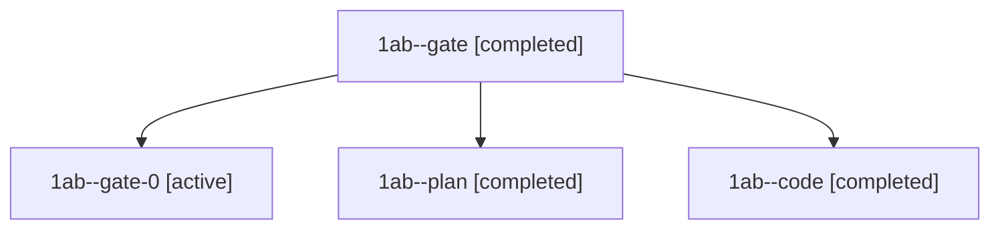

# Session: 1ab

[Agent Hoods](../README.md) / [bbugyi200](../users/bbugyi200/README.md) / [athena](../users/bbugyi200/machines/athena/README.md) / [1ab](../users/bbugyi200/machines/athena/hoods/1ab/README.md) / 1ab

Owner: `bbugyi200.athena` · Hood: `1ab` · Members: 4

## Lineage

The diagram is an optional enhancement; the ordered table below contains the same lineage in accessible text.

| Role | Agent | State | Model / provider | Timing | Commits | Prompt | Chat |
|---|---|---|---|---|---:|---|---|
| gate | 1ab--gate | completed | opus / claude | 2026-11-09T13:53:38.362750+00:00 → 2026-11-09T13:55:29.970569+00:00 | 0 | — | [Chat](../agents/bbugyi200.athena.1ab--gate/chat.md) |
| gate-0 | 1ab--gate-0 | active | grok-4.6 / grok | 2026-11-09T14:24:53.283353+00:00 | 0 | — | — |
| plan | 1ab--plan | completed | opus / claude | 2026-11-09T13:45:47.194478+00:00 → 2026-11-09T13:53:10.227896+00:00 | 0 | [Prompt](../agents/bbugyi200.athena.1ab--plan/prompt.md) | [Chat](../agents/bbugyi200.athena.1ab--plan/chat.md) |
| code | 1ab--code | completed | grok-4.6 / grok | 2026-11-09T13:56:15.728037+00:00 → 2026-11-09T14:24:38.824860+00:00 | [1](../agents/bbugyi200.athena.1ab--code/README.md#commits) | [Prompt](../agents/bbugyi200.athena.1ab--code/prompt.md) | [Chat](../agents/bbugyi200.athena.1ab--code/chat.md) |

## Commits

| Role | Repo | Commit | Subject | Committed |
|---|---|---|---|---|
| code | sase | [`99db9e6`](https://github.com/sase-org/sase/commit/99db9e685d58c0f3833e51f2a98f97bf98a4eb42) | fix(install): name -y in agent reinstall gate commands | 2026-11-09 09:23:35 EST |
