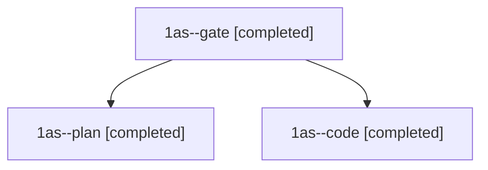

# Session: 1as

[Agent Hoods](../README.md) / [bbugyi200](../users/bbugyi200/README.md) / [athena](../users/bbugyi200/machines/athena/README.md) / [1as](../users/bbugyi200/machines/athena/hoods/1as/README.md) / 1as

Owner: `bbugyi200.athena` · Hood: `1as` · Members: 3

## Lineage

The diagram is an optional enhancement; the ordered table below contains the same lineage in accessible text.

| Role | Agent | State | Model / provider | Timing | Commits | Prompt | Chat |
|---|---|---|---|---|---:|---|---|
| gate | 1as--gate | completed | opus / claude | 2026-11-10T12:18:41.701177+00:00 → 2026-11-10T12:19:53.498435+00:00 | 0 | — | [Chat](../agents/bbugyi200.athena.1as--gate/chat.md) |
| plan | 1as--plan | completed | opus / claude | 2026-11-10T12:07:19.923006+00:00 → 2026-11-10T12:17:16.374994+00:00 | 0 | [Prompt](../agents/bbugyi200.athena.1as--plan/prompt.md) | [Chat](../agents/bbugyi200.athena.1as--plan/chat.md) |
| code | 1as--code | completed | muse-spark-1.3-contributor / muse | 2026-11-10T12:20:30.939466+00:00 → 2026-11-10T12:36:45.606470+00:00 | 0 | [Prompt](../agents/bbugyi200.athena.1as--code/prompt.md) | [Chat](../agents/bbugyi200.athena.1as--code/chat.md) |
