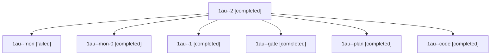

# Session: 1au

[Agent Hoods](../README.md) / [bbugyi200](../users/bbugyi200/README.md) / [athena](../users/bbugyi200/machines/athena/README.md) / [1au](../users/bbugyi200/machines/athena/hoods/1au/README.md) / 1au

Owner: `bbugyi200.athena` · Hood: `1au` · Members: 7

## Lineage

The diagram is an optional enhancement; the ordered table below contains the same lineage in accessible text.

| Role | Agent | State | Model / provider | Timing | Commits | Prompt | Chat |
|---|---|---|---|---|---:|---|---|
| 2 | 1au--2 | completed | grok-4.6 / grok | 2026-11-10T13:41:57.027176+00:00 → 2026-11-10T13:45:59.080398+00:00 | [1](../agents/bbugyi200.athena.1au--2/README.md#commits) | [Prompt](../agents/bbugyi200.athena.1au--2/prompt.md) | [Chat](../agents/bbugyi200.athena.1au--2/chat.md) |
| mon | 1au--mon | failed | grok-4.6 / grok | 2026-11-10T13:13:37.871743+00:00 → 2026-11-10T13:20:23.086769+00:00 | 0 | — | [Chat](../agents/bbugyi200.athena.1au--mon/chat.md) |
| mon-0 | 1au--mon-0 | completed | grok-4.6 / grok | 2026-11-10T13:26:46.601236+00:00 → 2026-11-10T13:40:46.250906+00:00 | 0 | — | [Chat](../agents/bbugyi200.athena.1au--mon-0/chat.md) |
| 1 | 1au--1 | completed | grok-4.6 / grok | 2026-11-10T13:21:29.040178+00:00 → 2026-11-10T13:28:13.666616+00:00 | 0 | [Prompt](../agents/bbugyi200.athena.1au--1/prompt.md) | [Chat](../agents/bbugyi200.athena.1au--1/chat.md) |
| gate | 1au--gate | completed | opus / claude | 2026-11-10T12:50:54.933284+00:00 → 2026-11-10T12:52:18.218085+00:00 | 0 | — | [Chat](../agents/bbugyi200.athena.1au--gate/chat.md) |
| plan | 1au--plan | completed | opus / claude | 2026-11-10T12:37:34.342940+00:00 → 2026-11-10T12:50:24.447247+00:00 | 0 | [Prompt](../agents/bbugyi200.athena.1au--plan/prompt.md) | [Chat](../agents/bbugyi200.athena.1au--plan/chat.md) |
| code | 1au--code | completed | grok-4.6 / grok | 2026-11-10T12:52:54.848197+00:00 → 2026-11-10T13:15:05.511973+00:00 | 0 | [Prompt](../agents/bbugyi200.athena.1au--code/prompt.md) | [Chat](../agents/bbugyi200.athena.1au--code/chat.md) |

## Commits

| Role | Repo | Commit | Subject | Committed |
|---|---|---|---|---|
| 2 | sase | [`04e50f3`](https://github.com/sase-org/sase/commit/04e50f31e705c1dce21e6e22a25ea20a21d3f0e5) | feat(sudo): snapshot remote executables and surface macOS TCC warnings | 2026-11-10 08:45:46 EST |
