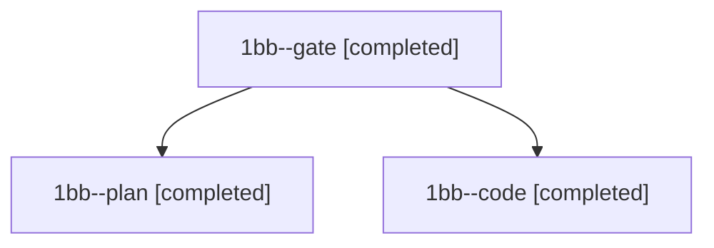

# Session: 1bb

[Agent Hoods](../README.md) / [bbugyi200](../users/bbugyi200/README.md) / [athena](../users/bbugyi200/machines/athena/README.md) / [1bb](../users/bbugyi200/machines/athena/hoods/1bb/README.md) / 1bb

Owner: `bbugyi200.athena` · Hood: `1bb` · Members: 3

## Lineage

The diagram is an optional enhancement; the ordered table below contains the same lineage in accessible text.

| Role | Agent | State | Model / provider | Timing | Commits | Prompt | Chat |
|---|---|---|---|---|---:|---|---|
| gate | 1bb--gate | completed | opus / claude | 2026-11-11T15:28:39.836359+00:00 → 2026-11-11T15:30:23.160949+00:00 | 0 | — | [Chat](../agents/bbugyi200.athena.1bb--gate/chat.md) |
| plan | 1bb--plan | completed | opus / claude | 2026-11-11T15:16:13.340715+00:00 → 2026-11-11T15:27:43.702838+00:00 | 0 | [Prompt](../agents/bbugyi200.athena.1bb--plan/prompt.md) | [Chat](../agents/bbugyi200.athena.1bb--plan/chat.md) |
| code | 1bb--code | completed | gpt-6-luna / codex | 2026-11-11T15:31:27.246530+00:00 → 2026-11-11T16:16:55.416169+00:00 | [1](../agents/bbugyi200.athena.1bb--code/README.md#commits) | [Prompt](../agents/bbugyi200.athena.1bb--code/prompt.md) | [Chat](../agents/bbugyi200.athena.1bb--code/chat.md) |

## Commits

| Role | Repo | Commit | Subject | Committed |
|---|---|---|---|---|
| code | sase | [`0eb9a0f`](https://github.com/sase-org/sase/commit/0eb9a0f06b6dc2824d806945ef62ecd463c070b3) | perf(agents-sync): cache publication protection lookups | 2026-11-11 11:16:39 EST |
