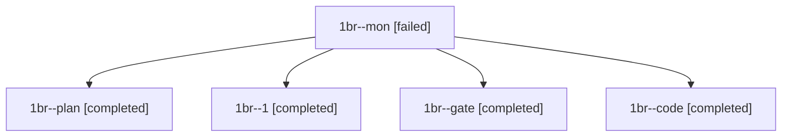

# Session: 1br

[Agent Hoods](../README.md) / [bbugyi200](../users/bbugyi200/README.md) / [athena](../users/bbugyi200/machines/athena/README.md) / [1br](../users/bbugyi200/machines/athena/hoods/1br/README.md) / 1br

Owner: `bbugyi200.athena` · Hood: `1br` · Members: 5

## Lineage

The diagram is an optional enhancement; the ordered table below contains the same lineage in accessible text.

| Role | Agent | State | Model / provider | Timing | Commits | Prompt | Chat |
|---|---|---|---|---|---:|---|---|
| mon | 1br--mon | failed | grok-4.6 / grok | 2026-11-12T13:03:28.669930+00:00 → 2026-11-12T13:47:42.961876+00:00 | 0 | — | [Chat](../agents/bbugyi200.athena.1br--mon/chat.md) |
| plan | 1br--plan | completed | claude-fable-5 / claude | 2026-11-12T11:00:44.641455+00:00 → 2026-11-12T11:16:18.714062+00:00 | 0 | [Prompt](../agents/bbugyi200.athena.1br--plan/prompt.md) | [Chat](../agents/bbugyi200.athena.1br--plan/chat.md) |
| 1 | 1br--1 | completed | grok-4.6 / grok | 2026-11-12T13:50:11.926381+00:00 → 2026-11-12T13:55:42.006068+00:00 | [1](../agents/bbugyi200.athena.1br--1/README.md#commits) | [Prompt](../agents/bbugyi200.athena.1br--1/prompt.md) | [Chat](../agents/bbugyi200.athena.1br--1/chat.md) |
| gate | 1br--gate | completed | claude-fable-5 / claude | 2026-11-12T11:18:02.100522+00:00 → 2026-11-12T11:20:19.363759+00:00 | 0 | — | [Chat](../agents/bbugyi200.athena.1br--gate/chat.md) |
| code | 1br--code | completed | grok-4.6 / grok | 2026-11-12T11:23:11.783112+00:00 → 2026-11-12T13:05:02.336280+00:00 | 0 | [Prompt](../agents/bbugyi200.athena.1br--code/prompt.md) | [Chat](../agents/bbugyi200.athena.1br--code/chat.md) |

## Commits

| Role | Repo | Commit | Subject | Committed |
|---|---|---|---|---|
| 1 | sase | [`8bb7bdc`](https://github.com/sase-org/sase/commit/8bb7bdc2317b89daed0988c8306b20b60978b082) | fix(bead): recover boot-failed nameless bead-work owners | 2026-11-12 08:55:23 EST |
