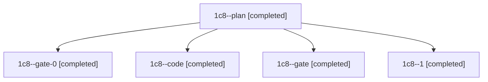

# Session: 1c8

[Agent Hoods](../README.md) / [bbugyi200](../users/bbugyi200/README.md) / [athena](../users/bbugyi200/machines/athena/README.md) / [1c8](../users/bbugyi200/machines/athena/hoods/1c8/README.md) / 1c8

Owner: `bbugyi200.athena` · Hood: `1c8` · Members: 5

## Lineage

The diagram is an optional enhancement; the ordered table below contains the same lineage in accessible text.

| Role | Agent | State | Model / provider | Timing | Commits | Prompt | Chat |
|---|---|---|---|---|---:|---|---|
| plan | 1c8--plan | completed | opus / claude | 2026-11-13T15:29:09.507063+00:00 → 2026-11-13T15:36:22.364788+00:00 | 0 | [Prompt](../agents/bbugyi200.athena.1c8--plan/prompt.md) | [Chat](../agents/bbugyi200.athena.1c8--plan/chat.md) |
| gate-0 | 1c8--gate-0 | completed | gpt-6-luna / codex | 2026-11-13T16:10:39.928448+00:00 → 2026-11-13T16:11:24.415398+00:00 | 0 | — | [Chat](../agents/bbugyi200.athena.1c8--gate-0/chat.md) |
| code | 1c8--code | completed | gpt-6-luna / codex | 2026-11-13T15:53:52.350787+00:00 → 2026-11-13T16:02:53.379699+00:00 | 0 | [Prompt](../agents/bbugyi200.athena.1c8--code/prompt.md) | [Chat](../agents/bbugyi200.athena.1c8--code/chat.md) |
| gate | 1c8--gate | completed | opus / claude | 2026-11-13T15:52:17.987965+00:00 → 2026-11-13T15:53:21.543932+00:00 | 0 | — | [Chat](../agents/bbugyi200.athena.1c8--gate/chat.md) |
| 1 | 1c8--1 | completed | gpt-6-luna / codex | 2026-11-13T16:12:57.117233+00:00 → 2026-11-13T16:15:40.096270+00:00 | 0 | [Prompt](../agents/bbugyi200.athena.1c8--1/prompt.md) | [Chat](../agents/bbugyi200.athena.1c8--1/chat.md) |
