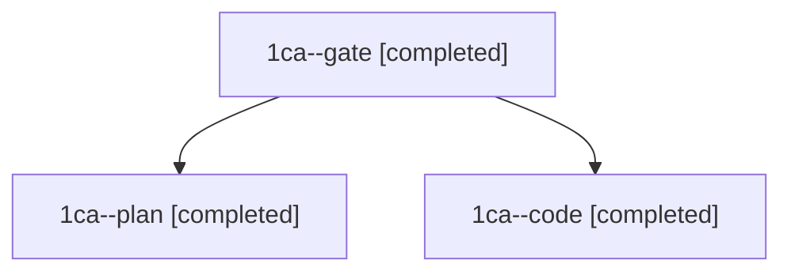

# Session: 1ca

[Agent Hoods](../README.md) / [bbugyi200](../users/bbugyi200/README.md) / [athena](../users/bbugyi200/machines/athena/README.md) / [1ca](../users/bbugyi200/machines/athena/hoods/1ca/README.md) / 1ca

Owner: `bbugyi200.athena` · Hood: `1ca` · Members: 3

## Lineage

The diagram is an optional enhancement; the ordered table below contains the same lineage in accessible text.

| Role | Agent | State | Model / provider | Timing | Commits | Prompt | Chat |
|---|---|---|---|---|---:|---|---|
| gate | 1ca--gate | completed | opus / claude | 2026-11-13T22:52:58.297436+00:00 → 2026-11-13T22:53:57.374030+00:00 | 0 | — | [Chat](../agents/bbugyi200.athena.1ca--gate/chat.md) |
| plan | 1ca--plan | completed | opus / claude | 2026-11-13T22:42:12.804013+00:00 → 2026-11-13T22:52:27.180694+00:00 | 0 | [Prompt](../agents/bbugyi200.athena.1ca--plan/prompt.md) | [Chat](../agents/bbugyi200.athena.1ca--plan/chat.md) |
| code | 1ca--code | completed | grok-4.6 / grok | 2026-11-13T22:54:26.796816+00:00 → 2026-11-13T23:47:13.347286+00:00 | [1](../agents/bbugyi200.athena.1ca--code/README.md#commits) | [Prompt](../agents/bbugyi200.athena.1ca--code/prompt.md) | [Chat](../agents/bbugyi200.athena.1ca--code/chat.md) |

## Commits

| Role | Repo | Commit | Subject | Committed |
|---|---|---|---|---|
| code | sase | [`e43206a`](https://github.com/sase-org/sase/commit/e43206a91e935fd7c9fb973b2b794889a92744c6) | docs: match word and agent workflow types to the charset rule | 2026-11-13 18:46:33 EST |
